# 课程资料问答与复习规划助手

一个面向**单门课程**的 RAG（检索增强生成）学习助手：把 PDF、PPTX、DOCX、TXT 等课程资料上传到后端，系统自动解析、分块并建立向量索引；学生可以用自然语言提问，并获得带文件名和页码的引用来源；还可以根据考试日期、章节和薄弱点生成逐日复习计划并导出 Markdown，或者基于资料生成填空题／选择题自测并自动判分。

界面使用 Streamlit，后端使用 FastAPI，二者通过 REST API 通信。

## 界面预览

前端为五页签结构：**资料管理 → 课程问答 → 复习计划 → 练习自测 → 课本原文**。界面按「书卷」风格定制：米白纸色、墨色正文、朱红印记，左侧为书脊式导航，答案引用改为脚注角标，复习计划排成边注式日程，判分结果用朱批样式呈现。

**资料管理**：上传时指定课程与章节，后端解析完成后立即建索引，页面回显页数、分块数与可用状态。

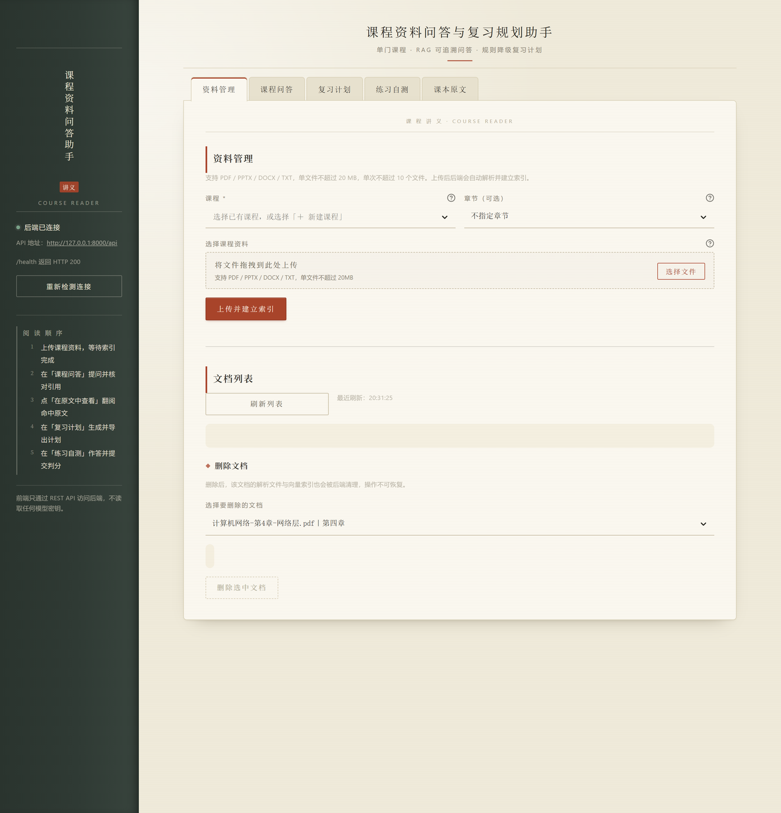

**文档列表**：展示每份资料的课程、章节、页数、分块数、状态与上传时间；删除会连同解析产物与向量一并清理。

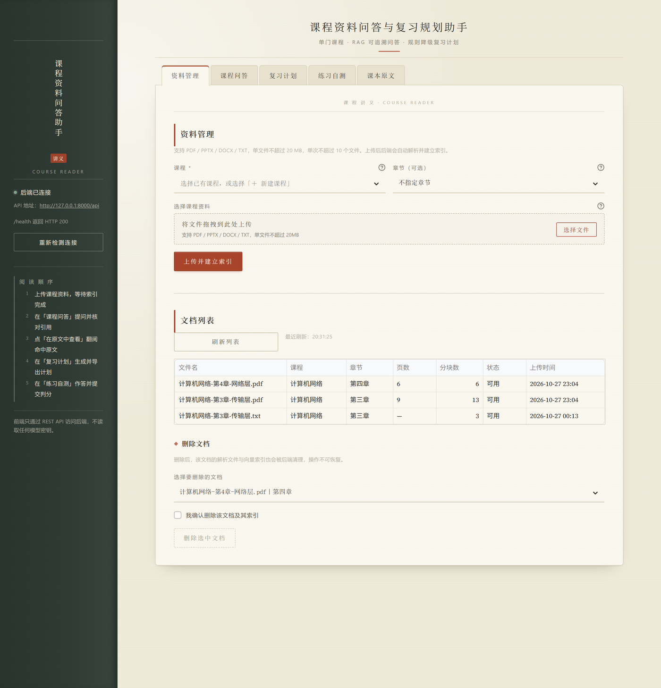

**课程问答**：每条结论后标注 `[来源:文件名 第X页]`，底部可展开原文片段核对；资料中确实没有的内容会单独列为「资料中未提及的内容」，而不是硬编一个答案。

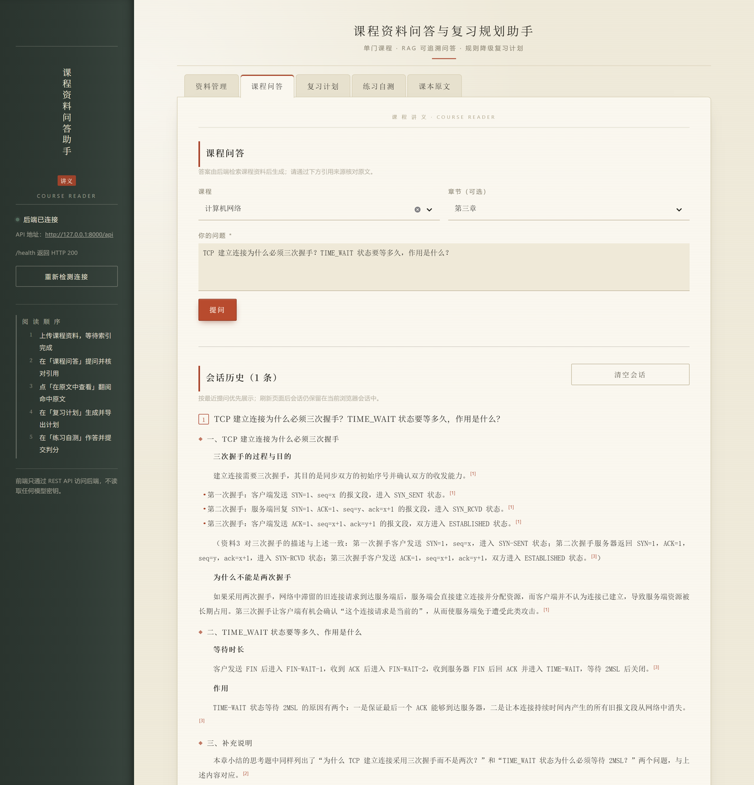

**引用跳转**：点来源脚注上的「在原文中查看」，问答页下方就地展开阅读器，自动翻到命中页并以高亮底色标出命中段落。

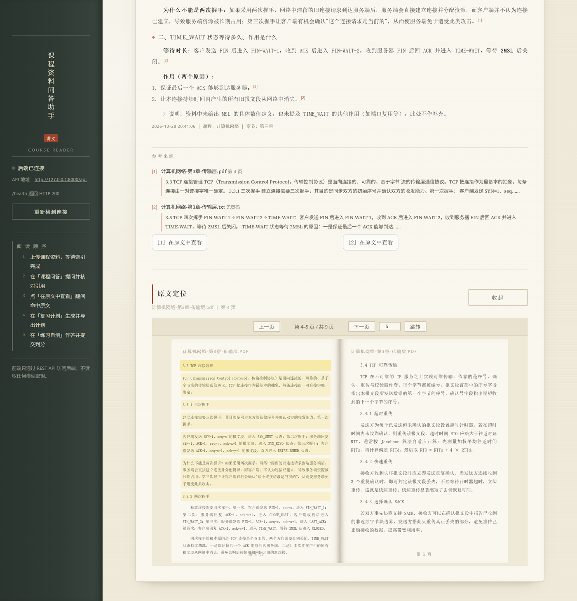

**课本原文**：左右对开翻书阅读，翻页时整张纸翻转、背面落到左侧，页码按跨页连续递增；有页码的资料一页对一页，支持按钮、键盘方向键与页码跳转。

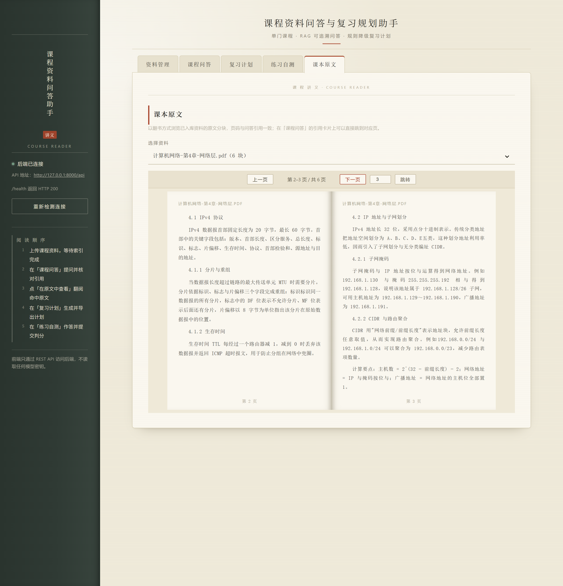

**复习计划与导出**：按考试日期生成逐日任务，薄弱章节前置并以「重点」标记；结果可一键导出 Markdown。

| 复习计划 | 导出结果 |
|---|---|
| 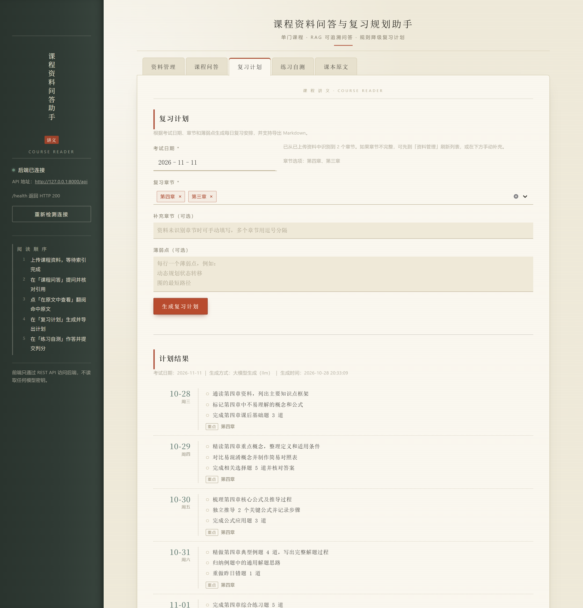 | 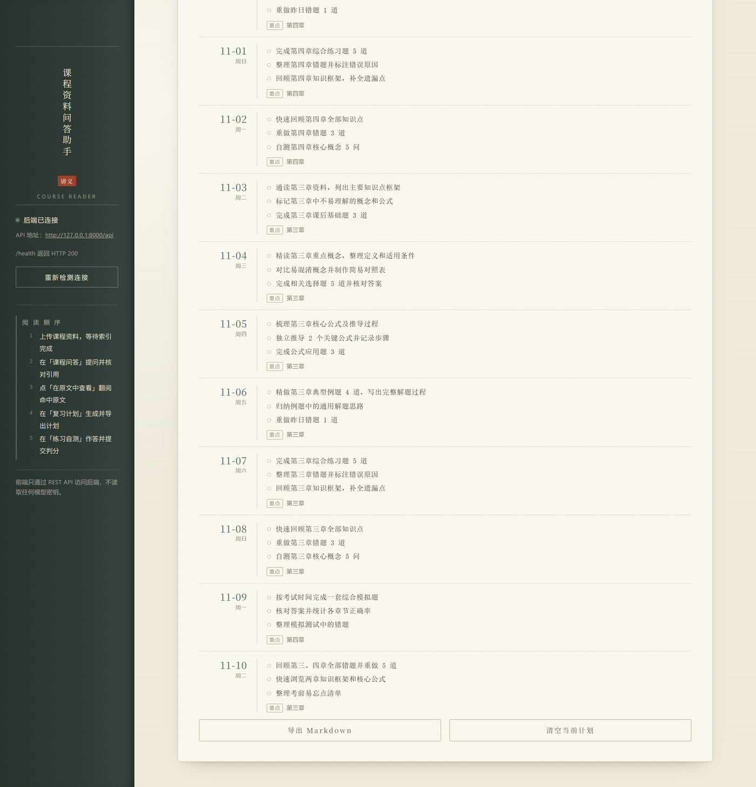 |

**练习自测**：按章节生成填空题与选择题，每题标注来源文件；提交后即时判分并给出标准答案与解析。

| 题目 | 判分结果 |
|---|---|
| 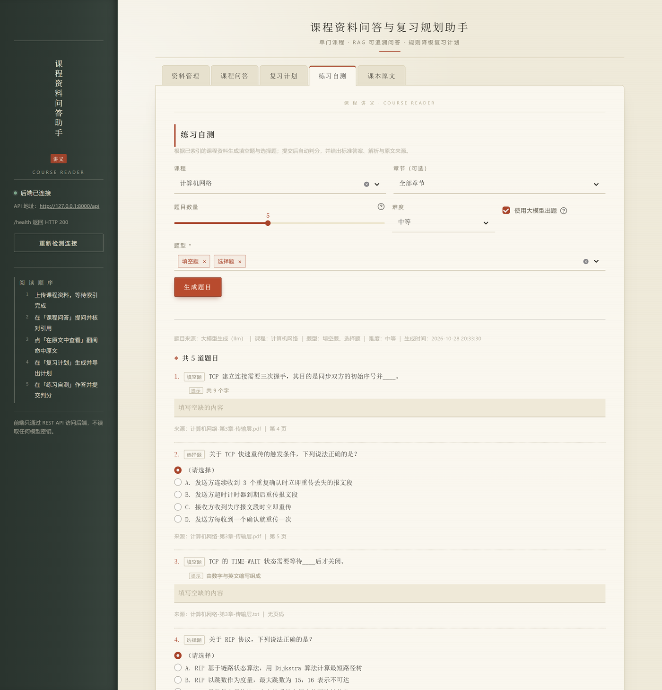 | 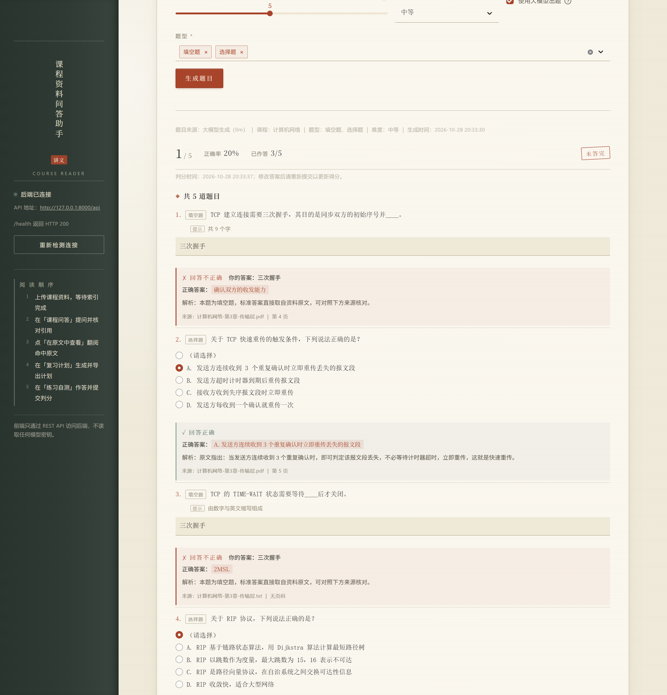 |

## 功能

### 1. 资料管理

- 批量上传 PDF / PPTX / DOCX / TXT 课程资料；
- 上传时填写课程名称和可选章节，后端自动解析并建立索引；
- 文档列表展示文件名、课程、章节、页数、分块数、索引状态和上传时间；
- 支持刷新列表，以及按 `doc_id` 删除文档及其向量、解析产物；
- 重复文件由后端按哈希识别，接口返回「已跳过」。

### 2. 课程问答

- 输入课程名称、可选章节和问题，按课程/章节范围检索；
- 展示中文答案；
- 每条答案下方展示引用来源列表：**文件名 + 页码 + 原文摘录**，便于回到资料核验；
- 会话历史保存在 `st.session_state`，支持多轮查看和一键清空；
- 后端不可达时给出启动提示，不抛出堆栈。

### 3. 复习计划

- 选择考试日期；
- 从已上传资料自动提取章节并多选，也支持手动补充章节；
- 输入薄弱点（每行一个，或使用逗号/分号分隔）；
- 一键调用后端生成逐日计划，表格展示「天 / 日期 / 学习重点 / 任务」；
- 使用 `st.download_button` 将计划导出为 Markdown；
- 当 `generated_by=rule` 时明确提示规则模板降级，计划仍可正常使用。

规则模板本身也按「基础巩固 → 强化练习 → 冲刺复盘」三阶段组织：每个阶段固定
读 / 练 / 查三个任务位，各有多条变体文案，按阶段内第几天取用，因此**即使只有
一个章节、计划长达数十天，每一天的学习重点与任务也不会重复**（同一阶段走完一
整轮后标注「第 N 轮」，表示进入下一遍复习）。

### 4. 练习自测

- 按课程（可选章节）生成填空题与选择题，单次 1–10 道，可选难度；
- 题目同样优先走大模型，失败时降级为规则生成（挖空 + 干扰项）；
- 作答后一键提交，自动判分并给出标准答案、解析和原文来源（文件名 + 页码）；
- 每道题都带 `source_file` 与 `page`，可以回到资料原文核对。

### 5. 课本原文

- 以**翻书**方式浏览已入库资料的原文分块，左右对开、3D 翻页动画，支持键盘方向键与页码跳转；
- 翻动的是一整张纸：正面印当前右页、背面印下一页，绕书脊转过 180° 后背面落到左侧，
  右边同时露出再下一页，所以页码按跨页连续递增，和翻纸质教材一样；
- 问答与练习题里的来源脚注带「在原文中查看」按钮，点击后在页面下方展开阅读器，
  自动翻到引用所在页并**高亮对应段落**；
- 有真实页码的资料（PDF / PPT）按原页码一页对一页，保证引用页码可以直接核对；
- 无页码的资料（TXT / DOCX）按每页约 360 字切成虚拟书页，否则整份资料只有一页，翻书失去意义。

阅读器是 `st.components.v1.html` 内嵌的 iframe。这样做的原因很实际：Streamlit 每次
交互都会重跑整个脚本、重建 DOM，无法承载需要持续 JS 状态的翻页动画，所以把渲染与翻页
完全交给 iframe 内部，Python 只在用户主动跳转时重新生成一次 HTML。代价是 iframe 高度
必须写死（`components.html` 不会按内容撑高），这一点在代码注释里也有说明。

## 架构

四层结构，层与层之间只通过 REST 契约通信，业务层是纯函数模块，方便单测和替换。

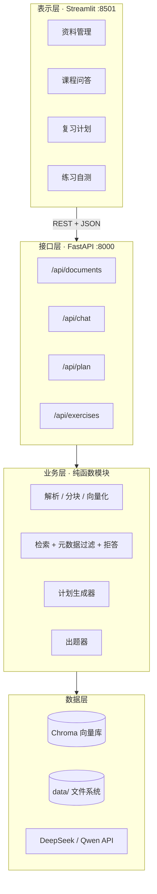

一条问答请求的链路：

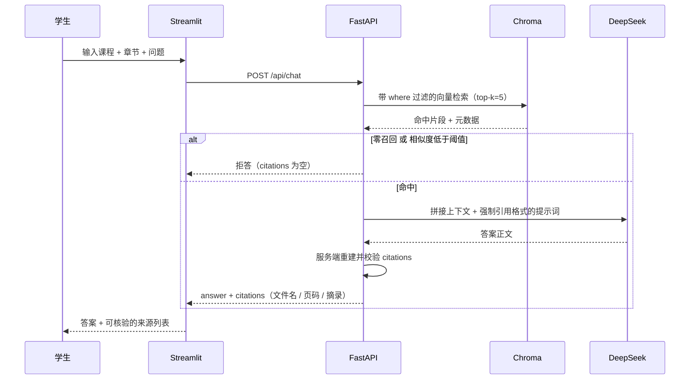

## 技术栈

| 层次 | 技术 |
| --- | --- |
| 前端 | Streamlit 1.41+、requests、Python 3.11 |
| 后端 | FastAPI、Uvicorn、Pydantic v2、pydantic-settings |
| RAG | LangChain、Chroma 向量库、Embedding（本地或 OpenAI 兼容 API） |
| 大模型 | DeepSeek Chat（默认）/ 通义千问（备用），OpenAI 兼容协议 |
| 文档解析 | pypdf、python-pptx、python-docx、TXT 解析 |
| 数据存储 | 本地文件 + Chroma + `data/` 下的 JSON/元数据 |
| 运行环境 | Windows PowerShell（也适用于 Linux/macOS） |

## 目录结构

```text
course-rag-assistant/
├── app/                        # FastAPI 后端（由后端模块提供）
│   ├── main.py                 # 应用入口、CORS、健康检查
│   ├── api/                    # /api/documents、/api/chat、/api/plan、/api/exercises 路由
│   ├── agents/                 # 复习计划与练习题生成器，均含规则降级
│   ├── core/                   # 配置、日志、公共异常
│   ├── models/                 # Pydantic 数据契约
│   ├── rag/                    # 解析、检索、生成、引用
│   └── services/               # 解析、分块、Embedding 等服务
├── frontend/
│   ├── streamlit_app.py        # Streamlit 五页签前端（含翻书式原文阅读器）
│   └── theme.py                # 书卷风样式与 HTML 片段（页眉、脚注、边注、朱批等）
├── docs/
│   ├── 需求分析说明书.md
│   ├── 总体设计文档.md
│   └── images/                 # README 界面截图
├── tests/                      # 前后端测试（33 个用例）
├── data/                       # 运行数据：上传、解析、Chroma、计划等（Git 忽略）
├── .env.example                # 全部环境变量示例
├── .gitignore
├── requirements.txt
├── run_backend.ps1             # 一键启动后端
├── run_frontend.ps1            # 一键启动前端
└── README.md
```

## 快速开始

### 1. 环境要求

- Windows 10/11 64 位（开发/演示环境）；
- Python 3.11.x，建议使用 64 位版本；
- 后端端口 `8000`，前端端口 `8501`（均可在命令中修改）；
- 使用在线大模型时需要能访问 DeepSeek 或通义千问 API；检索本身可在本地完成。

### 2. 创建虚拟环境

在项目根目录打开 PowerShell：

```powershell
cd D:\work\course-rag-assistant

# 创建名为 venv 的虚拟环境
python -m venv venv

# 激活（PowerShell）
.\venv\Scripts\Activate.ps1

# 如提示执行策略限制，可只对当前进程放开
# Set-ExecutionPolicy -Scope Process -ExecutionPolicy Bypass

# 安装依赖
python -m pip install --upgrade pip
pip install -r requirements.txt
```

CMD 用户激活命令为：

```bat
venv\Scripts\activate.bat
```

> 如果使用本地 Embedding（`EMBEDDING_MODE=local`），还需安装可选的 `sentence-transformers`；如果上传接口提示缺少表单解析依赖，请安装 `python-multipart`：
>
> ```powershell
> pip install sentence-transformers python-multipart
> ```
>
> 若本机无法下载模型，可改用 `EMBEDDING_MODE=api`，并填写对应的 Embedding API 配置。

### 3. 配置 `.env`

复制示例文件并编辑：

```powershell
Copy-Item .env.example .env
notepad .env
```

至少需要配置一个 LLM 供应商：

```dotenv
# 默认使用 DeepSeek
LLM_PROVIDER=deepseek
DEEPSEEK_API_KEY=sk-你的密钥
DEEPSEEK_BASE_URL=https://api.deepseek.com/v1
DEEPSEEK_MODEL=deepseek-chat
```

或者切换到通义千问：

```dotenv
LLM_PROVIDER=qwen
QWEN_API_KEY=你的 DashScope 密钥
QWEN_BASE_URL=https://dashscope.aliyuncs.com/compatible-mode/v1
QWEN_MODEL=qwen-plus
```

常用配置说明（完整项见 `.env.example`）：

| 配置项 | 说明 |
| --- | --- |
| `DEEPSEEK_API_KEY` | DeepSeek API 密钥，默认供应商必填 |
| `DEEPSEEK_BASE_URL` / `DEEPSEEK_MODEL` | DeepSeek 接口地址与模型名 |
| `QWEN_API_KEY` | 通义千问密钥，将 `LLM_PROVIDER` 改为 `qwen` 后使用 |
| `LLM_PROVIDER` | `deepseek` 或 `qwen` |
| `LLM_TIMEOUT` | 模型调用超时秒数，默认 60 |
| `LLM_TEMPERATURE` | 生成温度，默认 0.2 |
| `EMBEDDING_MODE` | `local`（本地模型）或 `api`（在线 Embedding） |
| `EMBEDDING_MODEL` / `EMBEDDING_DIM` | 本地模型名与向量维度，默认 384 |
| `EMBEDDING_API_KEY` / `EMBEDDING_API_BASE_URL` | API Embedding 模式下必填 |
| `CHUNK_SIZE` / `CHUNK_OVERLAP` | 文本分块大小与重叠字符数 |
| `TOP_K` | 检索返回的片段数 |
| `MAX_FILE_SIZE_MB` | 单文件大小上限，默认 20 MB |
| `DATA_DIR` / `CHROMA_DIR` | 运行数据与向量库目录 |
| `API_BASE_URL` | Streamlit 调用的后端 API 前缀，默认 `http://127.0.0.1:8000/api` |

安全提醒：`.env` 已被 `.gitignore` 忽略；模型密钥只由后端读取，Streamlit 前端不会也不能读取这些密钥。前端只会读取 `API_BASE_URL` 这一项。

### 4. 启动后端

终端 1（项目根目录）：

```powershell
# 已激活 venv 的情况下
uvicorn app.main:app --host 127.0.0.1 --port 8000 --reload
```

也可以使用一键脚本：

```powershell
.\run_backend.ps1
```

后端地址：

- API：http://127.0.0.1:8000/api
- Swagger 文档：http://127.0.0.1:8000/docs
- 健康检查：http://127.0.0.1:8000/api/health

### 5. 启动前端

终端 2（项目根目录，保持 venv 激活）：

```powershell
streamlit run frontend/streamlit_app.py --server.port 8501
```

也可以使用一键脚本：

```powershell
.\run_frontend.ps1
```

浏览器访问：http://127.0.0.1:8501

`run_frontend.ps1` 会自动读取 `.env` 中的 `API_BASE_URL`；如果没有配置，则使用 `http://127.0.0.1:8000/api`。

## 运行测试

测试全部离线运行：不访问网络，不调用真实大模型，Embedding 与向量库都用注入的假对象替换，所以**不配置 API Key 也能跑通**。

```powershell
.\venv\Scripts\python.exe -m pytest -q
```

当前 33 个用例，预期输出 `33 passed`：

| 文件 | 覆盖内容 |
| --- | --- |
| `tests/test_chain_smoke.py` | 问答主链路冒烟：`answer_question` 返回结构、引用来自检索元数据而非模型自由文本、零召回时的拒答、复习计划的 LLM/规则双路径、单章节多天计划不重复 |
| `tests/test_exerciser.py` | 出题器：题型轮转分配、参数校验、LLM 失败时降级为规则出题、来源字段完整性 |
| `tests/test_document_chunks.py` | 原文分块接口：多页分组与页码排序、`page=0` 无页码场景、文档存在但无分块、文档不存在返回 404、向量库异常时降级不报 500 |
| `tests/test_chat_citations.py` | 引用契约：保留 `doc_id/chunk_id/locator`（前端据此跳到原文）、嵌套 `metadata` 取值、缺文件名的引用被丢弃 |
| `tests/test_theme.py` | 书卷风渲染契约：HTML 转义、角标编号与脚注同号、重复来源去重、`**加粗**` 与列表被正确转成 HTML |

## 使用流程

1. **上传资料**：打开「资料管理」，填写课程名称（全程保持一致）和可选章节，选择文件后点击「上传并建立索引」。
2. **确认索引状态**：文档列表中状态为「可用」时代表已可检索；点击「刷新列表」可获取最新状态。
3. **课程问答**：切换到「课程问答」，填写相同课程名称；可填写章节缩小检索范围，然后提问。
4. **核对引用**：答案下方会列出文件名、页码和原文摘录。引用列表为空时，说明资料不足以支撑回答，建议补充相关章节。
5. **生成复习计划**：切换到「复习计划」，选择考试日期和章节，填写薄弱点，生成后查看每日安排。
6. **导出计划**：点击「导出 Markdown」保存复习计划；如果页面提示规则降级，可稍后在模型恢复后重新生成。
7. **练习自测**：切换到「练习自测」，选择课程（可选章节）、题目数量和难度，生成后作答并提交判分，可对照解析与原文来源复盘。
8. **回到原文**：在来源脚注上点「在原文中查看」，页面下方会展开翻书式阅读器并定位到该引用所在页；也可直接切到「课本原文」页签，选择资料后自由翻页。

## API 约定

前端依赖以下接口（后端默认监听 `http://127.0.0.1:8000`）：

| 方法 | 路径 | 用途 |
| --- | --- | --- |
| `POST` | `/api/documents/upload` | 上传文件（`files` 或 `file` 表单字段，另可带 `course`、`chapter`） |
| `GET` | `/api/documents` | 文档列表，返回 `items` 或直接列表 |
| `GET` | `/api/documents/{doc_id}/chunks` | 文档全部分块，按页码分组返回 `{pages: [{page, chunks}]}`，供原文阅读器使用 |
| `DELETE` | `/api/documents/{doc_id}` | 删除文档及索引 |
| `POST` | `/api/chat` | 请求 `{question, course, chapter?}`，返回 `{answer, citations}` |
| `POST` | `/api/plan` | 请求 `{exam_date, chapters, weak_points}`，返回 `{plan, generated_by}` |
| `POST` | `/api/exercises` | 请求 `{course, chapter?, count?, types?, difficulty?, use_llm?}`，返回 `{items, generated_by, warnings}` |
| `GET` | `/api/health` | 前端侧边栏连接探测 |

问答的 `citations` 至少包含：

```json
[
  {
    "source_file": "第3章_动态规划.pdf",
    "page": 12,
    "excerpt": "dp[i][j] = max(...)"
  }
]
```

复习计划的响应示例：

```json
{
  "plan": [
    {
      "day": 1,
      "date": "2026-10-27",
      "tasks": ["阅读课件第 10-14 页，整理状态定义", "手推 0-1 背包"],
      "focus": "第三章 动态规划"
    }
  ],
  "generated_by": "llm"
}
```

练习题的响应示例（`type` 为 `blank` 或 `choice`，每题都带来源）：

```json
{
  "course": "计算机网络",
  "chapter": "第三章",
  "items": [
    {
      "type": "blank",
      "stem": "TCP 通过 ____ 机制实现可靠传输。",
      "answer": "确认应答与重传",
      "hint": "与序号和定时器有关",
      "source_file": "计算机网络-第3章-传输层.txt",
      "page": 12
    },
    {
      "type": "choice",
      "stem": "下列哪一项属于传输层协议？",
      "options": ["IP", "TCP", "ARP", "ICMP"],
      "answer_index": 1,
      "explanation": "TCP 位于传输层；IP、ARP、ICMP 均属于网络层。",
      "source_file": "计算机网络-第3章-传输层.txt",
      "page": 3
    }
  ],
  "generated_by": "llm",
  "warnings": []
}
```

## 降级与容错说明

本项目按「先保证可用，再追求智能」的原则设计，常见的降级路径如下：

| 场景 | 表现 | 处理方式 |
| --- | --- | --- |
| 后端未启动 / 网络不通 | 页面显示「无法连接后端服务」，并给出启动命令 | 启动 `run_backend.ps1` 后点击「重新检测连接」或刷新页面 |
| 上传文件过大 / 格式不支持 | 前端先做格式和 20 MB 限制校验；后端仍会二次校验 | 压缩、拆分或转换为 PDF/DOCX/PPTX/TXT |
| 重复上传同一文件 | 后端按内容哈希识别并返回 `skipped` | 复用已有文档，无需重新索引 |
| 大模型超时 / 额度耗尽 / 未配置 Key | 问答链路降级为检索片段摘录，仍展示答案和引用；计划降级为规则模板 | 检查 `.env` 中的 `DEEPSEEK_API_KEY`；模型恢复后重新提问或生成计划 |
| 无有效检索结果 | 返回「资料不足」类回答且 `citations=[]` | 补充对应章节资料，或放宽章节筛选 |
| 复习计划 `generated_by=rule` | 页面显示黄色降级提示，下载按钮仍可用 | 计划可执行；稍后可重新生成以获得 LLM 优化版本 |
| 练习题 `generated_by=rule` | 题目由规则引擎挖空/生成干扰项，`warnings` 说明原因 | 题目仍可作答判分；模型恢复后重新生成即可 |
| Streamlit 侧边栏探测失败 | 红色「后端未连接」以及 API 地址 | 核对 `API_BASE_URL`、端口和防火墙设置 |

前端所有后端调用均有异常兜底，不会因为后端未启动或接口返回 4xx/5xx 而显示 Python 堆栈。

## 常见问题

**激活虚拟环境时报执行策略错误**

只对当前 PowerShell 进程放开：

```powershell
Set-ExecutionPolicy -Scope Process -ExecutionPolicy Bypass
.\venv\Scripts\Activate.ps1
```

**端口被占用**

修改启动端口，或在 PowerShell 中查看占用进程：

```powershell
Get-NetTCPConnection -LocalPort 8000,8501
```

**上传成功但文档列表为空**

点击「刷新列表」；确认后端日志；后端向量库初始化失败时会降级为本地元数据列表。

**问答没有引用**

可能当前问题没有命中资料，或章节筛选过窄。尝试清空章节、换一种问法，或上传更相关的资料。

**计划生成失败**

确认考试日期晚于今天；若后端提示 `PLAN_VALIDATION_FAILED`，请调整日期、每日时长或章节后重试。未选择章节时后端会尝试自动推断，建议手动补充更明确的章节。

**首次问答/上传很慢**

本地 Embedding 模型首次加载需要下载并加载模型，属于正常现象。若机器内存或网络受限，改用 `EMBEDDING_MODE=api`。

## 安全与隐私

- `.env` 不纳入版本控制，提交前检查是否误加真实密钥；
- 模型 API Key 只在后端进程中使用，Streamlit 前端只调用后端 API；
- 前端错误提示不会展示完整的密钥或堆栈；
- 本项目的 Chroma 数据和上传资料默认保存在本机 `data/` 目录，请按需备份或清理。

## 相关文档

- [需求分析说明书](docs/需求分析说明书.md)
- [总体设计文档](docs/总体设计文档.md)
