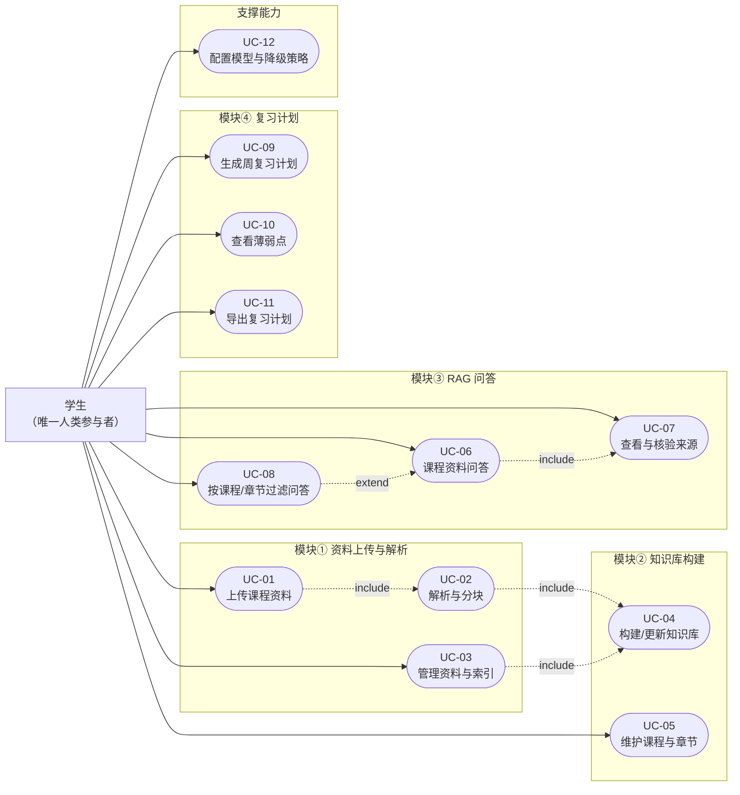
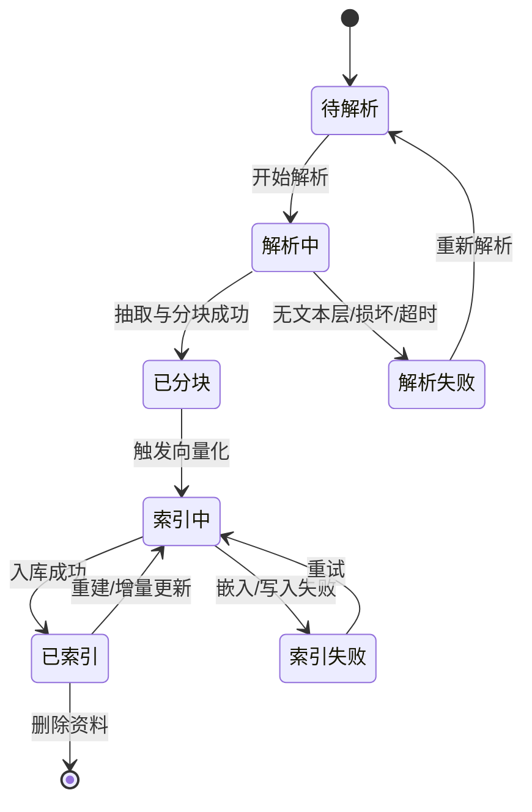
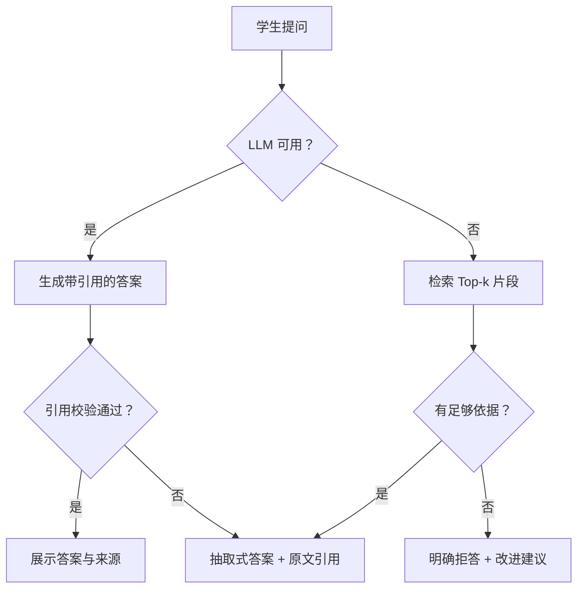

# 课程资料问答与复习规划助手 需求分析说明书

> 文档风格参照 GB/T 9385—2008《计算机软件需求规格说明规范》，并结合 GB/T 8567—2006 的文档组织要求编写。

| 项目 | 内容 |
|---|---|
| 文档编号 | CRAG-SRS-001 |
| 文档名称 | 课程资料问答与复习规划助手需求分析说明书 |
| 版本 | V1.0 |
| 文档状态 | 评审稿（需求基线候选） |
| 编制日期 | 2026-10-26 |
| 项目周期 | 1 周原型（单人开发） |
| 适用范围 | 单门课程垂直 RAG 助手的需求、设计、开发与验收 |
| 编制/评审 | 项目组 / 课程教师或同行评审 |

## 文档说明

本文档描述“课程资料问答与复习规划助手”的产品需求基线，回答“为谁做、做什么、做到什么程度、如何验收”四个问题。文中“必须（Must）”需求是原型交付和验收的硬性条件；“应当（Should）”需求在资源允许时实现；“可以（Could）”需求不进入本期验收，仅作为后续演进方向。

需求编号规则：用户故事使用 `US-xx`，用例使用 `UC-xx`，功能需求使用 `FR-xx`，非功能需求使用 `NFR-xx`，风险使用 `R-xx`，验收指标使用 `M-xx`。所有编号在全文保持唯一，并可在附录 A 的需求追踪矩阵中交叉查询。

---

## 1 引言

### 1.1 目的

本文档的目标是：

1. 明确课程资料问答与复习规划助手的产品边界、目标用户、核心场景和可验证的需求。
2. 将“上传资料—建库—检索—问答—引用—复习规划”这一完整链路拆解为可实现、可测试的功能项和用例。
3. 为设计、编码、测试、验收和后续迭代提供统一依据，减少开发过程中因“通用聊天机器人”想象而造成的范围蔓延。
4. 明确 RAG 问答的可信性要求，尤其是“答案必须有来源、来源必须可核验”这一不可妥协的质量底线。
5. 明确当大模型 API 不可用、解析失败或索引损坏时的降级行为，保证原型在受限环境下仍然可用、可演示、可验收。

本文档的预期读者及关注点如下：

| 读者 | 关注重点 |
|---|---|
| 课程教师/评审人 | 产品是否真正解决本课程学习问题，边界是否合理，验收是否可操作 |
| 开发者 | 功能范围、数据对象、接口约束、优先级和降级逻辑 |
| 测试/验收人员 | 用例流程、量化指标、评测集构造方法和判定规则 |
| 后续维护者 | 模块边界、配置项、数据留存方式和扩展点 |
| 学生试用者 | 上传是否简单、回答是否可信、引用是否找得到、计划是否能执行 |

### 1.2 背景与问题

#### 1.2.1 课程资料的真实状态

一门大学课程的资料通常分散在多个载体中：

- 教师课件：PPT/PDF，按周或按章节命名，版本多，重点常藏在图表、备注和口头补充中。
- 教材与讲义：PDF 或 Word，篇幅长，概念定义、公式推导和例题分布在不同页码。
- 实验指导书：Word/PDF，包含环境配置、步骤、注意事项和报告要求。
- 往年题与习题：PDF、图片或零散文本，常缺少标准答案，章节归属不清晰。
- 学生自己的笔记：TXT、Markdown 或纸质拍照，格式不统一。

这些资料往往以“文件”为单位存放，而不是以“知识”为单位组织。学生知道“老师讲过”，却很难快速定位“哪一页、哪一段、哪张幻灯片”。

#### 1.2.2 现有解决方式的不足

| 痛点 | 具体表现 | 后果 |
|---|---|---|
| 资料分散 | 课件、教材、实验指导书、往年题分别存放在网盘、课程群、邮箱和本地文件夹 | 找资料靠记忆和翻目录，重复下载、版本混淆 |
| 检索原始 | 只能按文件名或 Ctrl+F 字面匹配，无法按语义找“这个概念和哪个例子有关” | 同义表述、跨章节内容、图表附近的解释难以命中 |
| 概念割裂 | 定义在教材、例题在课件、实验在指导书，需要人工来回对照 | 理解成本高，容易只记住结论不理解适用条件 |
| 通用大模型不可信 | 通用模型不了解本课程教材、教师口径和实验环境，可能编造定义、公式、页码 | 看似流畅但无法核验，用于作业或复习存在风险 |
| 来源缺失 | 普通聊天回答通常不给出来源，或只给一个无法定位的链接 | 学生无法判断答案是否适用于本课程，也无法回到原文 |
| 规划凭感觉 | 复习计划多靠“还剩几天、哪章没看”的粗略判断，薄弱点与时间分配脱节 | 计划不可执行，考前才发现重点章节没覆盖 |
| 往年题利用不足 | 题目散落，缺少章节标签和知识点归并 | 无法把“做错题”转化为“本周复习任务” |

#### 1.2.3 机会与产品思路

RAG（Retrieval-Augmented Generation，检索增强生成）的基本思路是：先从课程资料中检索与问题相关的片段，再让大模型在这些片段的约束下组织答案，并返回片段来源。它不能消除所有幻觉，但可以把“开放域自由生成”变成“有资料依据的受控生成”，使答案具备可检查性。

本项目进一步把“问答”与“复习规划”连接起来：问答记录不仅用于即时答疑，也用于暴露薄弱章节和知识点；复习计划再把这些薄弱点、已覆盖章节和考试日期纳入周任务。这样形成一个闭环：

> 上传资料 → 建立可过滤的课程知识库 → 带来源的问答 → 识别薄弱点 → 生成周复习计划 → 按计划继续提问和补漏。

产品不追求“什么都能答”，而追求“在这门课的资料范围内，答得有依据、指得回原文、计划能执行”。

### 1.3 范围

#### 1.3.1 本期范围

本期交付一个可本地运行的单机 Web 原型，包含四大功能模块和必要的支撑能力：

| 模块 | 本期包含的能力 | 对应用例 |
|---|---|---|
| ① 资料上传与解析 | 上传 PDF/PPT/Word/TXT；格式与大小校验；文本抽取；按章节/页码/段落分块；解析状态与错误提示；资料查看、删除、重新解析 | UC-01、UC-02、UC-03 |
| ② 知识库构建 | 课程空间与章节元数据；文本向量化；写入本地 Chroma；增量更新与重建；按课程/章节过滤检索；索引统计 | UC-04、UC-05 |
| ③ RAG 问答 | 自然语言提问；Top-k 检索；受控生成；逐条来源引用到文件/页/段；按课程/章节过滤；无依据拒答；问答历史 | UC-06、UC-07、UC-08 |
| ④ 复习计划生成 | 输入考试日期、已覆盖章节、每周可用时间、薄弱点；智能体生成周计划；规则模板降级；计划查看、调整、导出 | UC-09、UC-10、UC-11 |
| 支撑能力 | 模型与 API 配置；连通性检查；降级状态提示；本地日志；数据清理 | UC-12 |

#### 1.3.2 产品边界：只做一门课

本产品是“单门课程垂直助手”，不是“万能校园助手”。边界如下：

**做：**

- 围绕一门主课程的资料组织、检索、问答和复习规划。
- 允许在同一本地实例中保留少量课程资料空间（建议不超过 3 个，例如同一门课的不同学期、不同教学班，或与本课程强相关的先修课补充资料），以支持“按课程过滤”；产品界面、文案和验收仍以一门主课程为中心。
- 对课程资料中的文本内容进行解析和引用；对 PDF 页码、PPT 幻灯片序号、Word 段落序号、TXT 行号建立可追溯定位。
- 在模型可用时使用轻量智能体生成复习计划；在模型不可用时使用确定性的规则模板。
- 明确展示“答案来自哪里、是否经过模型总结、当前是否处于降级模式”。

**不做：**

- 不做面向全校的课程目录、选课、成绩、教务、培养方案等校园平台能力。
- 不做多用户注册、登录、权限、班级协作、云端多租户；本期为单机单用户。
- 不做扫描件 OCR、手写识别、公式 OCR、图表内容理解；纯图片 PDF 会给出明确错误提示，而不是静默产出空索引。
- 不做视频、音频、PPT 动画、图片内容的解析。
- 不做自动出题、押题、作业代写、考试作弊辅助；往年题只作为普通课程资料被检索和引用。
- 不做模型训练或微调；使用预训练嵌入模型和外部/本地大模型 API。
- 不做移动端 App、小程序、实时协作、云同步。
- 不承诺覆盖所有版式和所有文件；对加密、损坏、超限文件明确拒绝并给出处理建议。
- 不把通用大模型的世界知识当作课程事实；答案必须以检索到的课程资料为依据。

#### 1.3.3 产品成功的定义

原型在真实课程资料上完成以下闭环，即视为产品层面成功：

1. 学生能在 5 分钟内完成“上传一份资料 → 建立索引 → 提出第一个问题”。
2. 每条实质性回答都能展开看到至少一条有效来源，来源能定位到文件、页码/幻灯片/段落和原文片段。
3. 在 3—5 门课的小型评测集上，答案被检索内容支撑的比例不低于 90%，来源正确率不低于 90%，可追溯率达到 100%。
4. 学生输入考试日期、已覆盖章节和薄弱点后，能在 30 秒内得到一份按周组织、包含任务与时长、可导出、可执行的复习清单。
5. 在大模型 API 断开或密钥无效时，系统仍能返回带引用的原文摘录或明确拒答，并能用规则模板生成复习计划。

### 1.4 术语与缩略语

| 术语/缩写 | 全称或含义 | 在本项目中的具体含义 |
|---|---|---|
| RAG | Retrieval-Augmented Generation，检索增强生成 | 先检索课程片段，再基于片段生成答案 |
| LLM | Large Language Model，大语言模型 | 通过 API 调用的生成模型，用于答案组织和计划生成 |
| Embedding | 文本向量化 | 将文本块转换为向量，用于相似度检索 |
| Chunk | 文本块 | 解析后按语义/长度切分的最小检索单元，携带页码/段落等元数据 |
| Chroma | 开源向量数据库 | 本地持久化向量、文本和元数据，支持 `where` 过滤 |
| Top-k | 检索返回的前 k 个结果 | 本期默认 k=5，可按配置调整 |
| 引用 | Citation | 答案中标注的 `[S1]` 等来源编号，对应具体文件与页/段 |
| 可追溯 | Traceability | 从答案能回到原始资料的具体位置，并核对原文 |
| 薄弱点 | Weak Point | 由拒答、低置信、重复提问、用户自评或练习暴露出的章节/知识点 |
| 智能体 | Agent | 本期指“带结构化输入、工具调用和输出校验的轻量规划器”，不是自主多智能体系统 |
| 降级 | Degradation | 某个依赖不可用时，切换到更简单但可用的确定性路径 |
| 规则模板 | Rule-based Template | 不依赖 LLM 的复习计划生成算法，按优先级和时间配额排程 |
| OCR | Optical Character Recognition，光学字符识别 | 从图片中识别文字；本期不做 |
| Token | 模型计费/上下文单位 | 用于控制上下文长度和成本 |
| P95 | 95 分位值 | 95% 的请求低于该指标值，用于性能验收 |
| SRS | Software Requirements Specification | 软件需求规格说明，即本文档 |

### 1.5 参考资料

| 编号 | 资料 | 用途 |
|---|---|---|
| [1] | GB/T 9385—2008《计算机软件需求规格说明规范》 | 文档结构、需求条目化和可验证性参考 |
| [2] | GB/T 8567—2006《计算机软件文档编制规范》 | 文档编制与版本管理参考 |
| [3] | ISO/IEC/IEEE 29148:2018《Systems and software engineering — Life cycle processes — Requirements engineering》 | 需求质量属性（必要、无歧义、可验证、可追踪）参考 |
| [4] | GB/T 25000.51—2016《系统与软件工程 系统与软件质量要求和评价（SQuaRE）第 51 部分：就绪可用软件产品（RUP）的质量要求和测试细则》 | 功能性、性能效率、易用性、可靠性、可移植性等质量特性参考 |
| [5] | Chroma 官方文档，https://docs.trychroma.com/ | 本地持久化、集合与元数据过滤接口 |
| [6] | Streamlit 官方文档，https://docs.streamlit.io/ | 前端页面、文件上传、状态管理与部署约束 |
| [7] | Sentence-Transformers 文档，https://www.sbert.net/ | 本地嵌入模型加载与批量编码 |
| [8] | BAAI/bge-small-zh-v1.5 模型卡，https://huggingface.co/BAAI/bge-small-zh-v1.5 | 中文轻量嵌入模型选型参考 |
| [9] | Lewis et al., “Retrieval-Augmented Generation for Knowledge-Intensive NLP Tasks”, NeurIPS 2020, arXiv:2005.11401 | RAG 方法背景 |
| [10] | OWASP Top 10 for LLM Applications，https://genai.owasp.org/llm-top-10/ | 提示词注入、敏感信息泄露、过度代理等风险参考 |

---

## 2 项目概述

### 2.1 产品定位

**一句话定位：** 面向一名大学生的、本地运行的、单门课程资料问答与复习规划助手；回答必须能回到课程原文，计划必须能落到每周任务。

产品定位包含四个关键词：

1. **课程内**：只回答与本课程资料相关的问题；不承担通用百科、闲聊、校园事务咨询。
2. **可信优先**：宁可拒答，也不编造；没有来源的答案不展示为“课程答案”。
3. **闭环**：问答暴露的薄弱点要能进入复习计划，而不是问答和规划两个孤岛。
4. **轻量可降级**：单机、无 GPU、一周原型；外部模型不可用时仍有确定性路径。

### 2.2 用户画像

本期只有一个主要人类角色：**本课程的学生**。教师是资料提供者和需求评审者，不作为系统登录角色；系统管理员能力由学生在本地兼任。

| 画像项 | 描述 |
|---|---|
| 姓名/代号 | 小林 |
| 身份 | 大三本科生，正在修读一门专业核心课 |
| 课程形态 | 每周 2 次课，含课件、教材章节、实验指导书和往年题 |
| 设备环境 | Windows 11 笔记本，4 核 CPU、16 GB 内存、无独立 GPU、SSD |
| 网络环境 | 校园网/家庭网络，可访问大模型 API，但可能不稳定或限流 |
| 数字素养 | 会使用浏览器和常见办公软件；不要求会命令行，但按 README 操作可以完成本地启动 |
| 当前做法 | 用文件夹和文件名管理资料；复习时翻课件、看教材、问同学、偶尔问通用聊天机器人 |
| 核心目标 | 快速找到课程内的准确解释；知道答案出处；在考前把时间分配到真正薄弱的章节 |
| 核心痛点 | 资料太多找不到；通用模型答得流畅但不敢信；复习计划靠感觉，执行两天就乱 |
| 可接受成本 | 愿意自备 API key；接受首次配置 10—15 分钟；不愿为原型付费购买服务器 |
| 成功体验 | “我问一个概念，它告诉我课件第 3 页和教材第 42 页怎么讲；考前它把我不会的章节排进每周任务。” |

**角色边界：**

- 学生是资料的上传者、知识的消费者、计划的执行者，也是薄弱点的最终确认者。
- 系统不替代教师评分、不给出官方考试范围、不承诺答案绝对正确。
- 本期不区分“学生/助教/教师”权限；所有操作都在同一本地用户下完成。

### 2.3 典型使用场景

**场景 A：课后作业卡住**

小林在做第 4 章作业，遇到“为什么这个算法的时间复杂度是 O(n log n)”的问题。他打开助手，选择“第 4 章”，提问后得到一段基于课件和教材的解答，答案中 `[S1]` 指向课件第 18 张幻灯片，`[S2]` 指向教材第 96 页第 3 段。他点开引用，看到原文推导，确认不是模型编的。

**场景 B：章节复习**

他准备复习第 3 章，但不确定“树的遍历”和“递归”之间的关系。他用自然语言提问，并只勾选第 3 章，避免检索到后面还没学的章节。答案把课件中的定义、教材中的例子和实验指导书中的递归实现串起来，每条都有来源。

**场景 C：考前两周**

他输入考试日期、已经复习完的章节、每周可投入的 8 小时，以及问答中暴露的两个薄弱点。系统生成 2—4 周的周计划：每周有章节目标、具体任务、预计时长、对应薄弱点和完成标准。模型不可用时，系统自动切换到规则模板，仍然给出一份可执行的清单。

### 2.4 假设

| 编号 | 假设 | 影响 |
|---|---|---|
| A-01 | 学生拥有课程资料的合法使用权，并有权将其用于本地学习 | 资料合规由用户负责；产品不提供盗版资源 |
| A-02 | PDF 具备可提取的文本层；PPT/Word 为可解析的现代格式 | 扫描件、图片型 PDF 不在支持范围 |
| A-03 | 运行时可以访问大模型 API；允许短时断网 | 决定生成能力；断网时走降级路径 |
| A-04 | 学生自备 API key，并了解调用可能产生费用 | 产品不内置密钥、不代付费用 |
| A-05 | 单机、单用户、单会话为主，无并发写 | 不需要分布式锁、队列和多租户隔离 |
| A-06 | 考试日期、章节范围和已覆盖情况由学生提供 | 计划质量依赖输入真实性；系统不自动推断教学进度 |
| A-07 | 资料以中文为主，允许中英混合术语 | 嵌入模型和分块策略以中文为主 |
| A-08 | 开发期为 1 周，1 名开发者完成原型 | 功能优先级必须严格收敛，先保证 Must |
| A-09 | 学生具备判断“答案是否被原文支撑”的基本能力 | 人工评测可行；产品需提供原文片段辅助判断 |
| A-10 | 运行设备至少 4 核 CPU、8 GB 内存、5 GB 可用磁盘，无 GPU | 本地嵌入与 Chroma 可在 CPU 上运行 |
| A-11 | 单文件不超过 50 MB，单课程资料不超过 100 篇 | 用于性能目标和容量边界 |
| A-12 | 学生愿意在首次使用时完成模型配置和一次索引构建 | 首次使用有 10—15 分钟准备成本 |

### 2.5 约束

| 编号 | 约束 | 说明 |
|---|---|---|
| C-01 | 前端使用 Streamlit | 单页/多页快速原型；不引入独立前端工程 |
| C-02 | 后端使用 Python 3.10—3.11 | 兼顾 Chroma、Sentence-Transformers、Streamlit 的兼容性 |
| C-03 | 向量库使用本地 Chroma 持久化模式 | 不依赖云向量数据库；数据留在本机 |
| C-04 | 采用轻量智能体 | 单次结构化规划调用 + JSON 校验 + 规则降级，不引入重型多智能体编排 |
| C-05 | 本地运行，默认绑定 `127.0.0.1` | 单机单用户；不暴露公网 |
| C-06 | API key 由用户自备，存放在本地环境变量或本地配置文件 | 不写入代码、不写入日志、不提交版本库 |
| C-07 | 1 周内交付原型 | Must 优先；Should 可裁剪；Could 不承诺 |
| C-08 | 不进行模型训练/微调 | 使用现成嵌入模型和生成模型 |
| C-09 | 不做 OCR | 扫描件明确提示用户先做 OCR 或转换为文本 |
| C-10 | 单文件 ≤50 MB、单课程 ≤100 篇、总容量 ≤2 GB | 超出则拒绝并提示拆分/清理 |
| C-11 | 答案只允许基于检索到的课程资料 | 不允许用模型世界知识补充课程事实 |
| C-12 | 单轮问答为主 | 每次提问独立检索；不承诺跨轮指代消解 |

### 2.6 产品级成功指标

| 维度 | 目标 |
|---|---|
| 可用性 | 新用户按 README 在 30 分钟内完成安装和首次启动 |
| 首次价值 | 从上传到第一个带来源答案 ≤5 分钟 |
| 可信性 | 实质性回答的可追溯率 100%；评测集答案支撑率 ≥90% |
| 计划性 | 计划包含周次、日期、章节、任务、时长、薄弱点、完成标准；人工可用性 ≥4.0/5 |
| 鲁棒性 | LLM 不可用、无密钥、索引损坏、扫描件等场景均有明确提示或降级路径，不崩溃、不静默失败 |
| 可移植性 | Windows 11 与 Ubuntu 22.04 均可按文档启动并通过冒烟测试 |
| 隐私性 | API key 不泄露；资料默认只存本地；调用第三方 API 前有明确告知 |

---

## 3 用户故事

### 3.1 用户故事清单

| 编号 | 角色 | 故事摘要 | 优先级 | 关联用例 |
|---|---|---|---|---|
| US-01 | 学生 | 上传课程资料并自动解析，以便把分散的文件变成可检索的知识库 | 必须 | UC-01、UC-02 |
| US-02 | 学生 | 建立带课程/章节标签的知识库，以便检索时能缩小范围 | 必须 | UC-04、UC-05 |
| US-03 | 学生 | 用自然语言提问并获得基于课程资料的答案，以便快速理解概念 | 必须 | UC-06 |
| US-04 | 学生 | 查看答案的原始来源（文件、页/段、原文），以便核验答案是否可信 | 必须 | UC-07 |
| US-05 | 学生 | 按课程/章节过滤后提问，以便只看当前学习范围 | 必须 | UC-08 |
| US-06 | 学生 | 根据考试日期、已覆盖章节和薄弱点生成周复习计划，以便把时间用在刀刃上 | 必须 | UC-09、UC-11 |
| US-07 | 学生 | 查看问答暴露的薄弱点并纳入计划，以便形成“提问—补漏—复习”的闭环 | 必须 | UC-10 |
| US-08 | 学生 | 在大模型不可用时仍能获得原文摘录或规则计划，以便不中断学习 | 应当 | UC-06、UC-09、UC-12 |
| US-09 | 学生 | 管理已上传资料并重建索引，以便修正解析错误或删除过时资料 | 应当 | UC-03 |

### 3.2 用户故事详述

#### US-01 上传并自动解析课程资料

- **作为（As a）**：正在复习本课程的学生。
- **我希望（I want）**：把课件、教材、实验指导书和往年题直接上传，系统自动识别格式、抽取文字并按章节/页码切分。
- **以便（So that）**：我不用手工复制粘贴，也不用先整理成统一格式，就能开始提问。

**验收要点：**

1. 支持 `.pdf`、`.pptx`、`.docx`、`.txt` 四类文件；不支持的格式给出明确提示，不产生半成品记录。
2. 上传成功后能看到文件状态从“待解析”变为“已分块/已索引”，失败时能看到具体原因。
3. 解析结果保留页码、幻灯片序号或段落序号，后续引用能回到这些位置。
4. 重复上传同一文件时，系统能识别并让用户选择跳过或保留新版本。
5. 超过 50 MB（TXT 超过 10 MB）的文件被拒绝，并提示拆分或压缩。

**关联：** UC-01、UC-02、FR-01～FR-07、NFR-05、NFR-12。

#### US-02 建立可过滤的课程知识库

- **作为（As a）**：要复习多份资料的学生。
- **我希望（I want）**：系统把解析后的内容向量化并写入本地知识库，同时保留课程、章节、文件、页码等标签。
- **以便（So that）**：我提问时可以按课程或章节过滤，而不是在全部资料里大海捞针。

**验收要点：**

1. 每个文本块都带有课程、文件、章节、页码/段落等元数据；缺少章节时归入“未分类”，不丢失。
2. 索引构建有进度和统计（文档数、块数、成功/失败数），失败可重试。
3. 重新上传新版本或删除旧资料后，索引能增量更新或重建，不出现“旧答案仍被引用”。
4. 按课程/章节过滤时，检索结果和最终引用都不越界。

**关联：** UC-04、UC-05、FR-08～FR-14、NFR-06、NFR-13。

#### US-03 用自然语言提问并获得有依据的答案

- **作为（As a）**：遇到概念、公式、实验步骤问题的学生。
- **我希望（I want）**：用日常语言提问，系统先从课程资料中找依据，再组织成易懂的答案，而不是直接自由发挥。
- **以便（So that）**：我能快速理解课程口径，而不是在多个文件之间来回翻找。

**验收要点：**

1. 问题可以是完整问句、关键词或“为什么/怎么理解/有什么区别”等自然表达。
2. 答案开头或结尾明确说明“基于课程资料”；不使用“根据常识”“一般来说”等脱离资料的说法。
3. 每个实质性回答至少带 1 条有效引用；没有足够依据时明确拒答，并给出改问建议。
4. 回答中不出现无法在引用片段中找到依据的具体数字、公式、页码或结论。
5. 响应时间在资料规模内达到 NFR 目标；超时时有降级提示，而不是无限等待。

**关联：** UC-06、FR-15～FR-18、NFR-01、NFR-07、NFR-08。

#### US-04 查看并核验答案来源

- **作为（As a）**：不敢直接相信 AI 答案的学生。
- **我希望（I want）**：点开答案中的 `[S1]`、`[S2]` 就能看到文件名、章节、页码/幻灯片/段落和原文片段。
- **以便（So that）**：我能自己判断答案是否被原文支撑，而不是被动接受。

**验收要点：**

1. 每条引用显示文件标题、文件类型、章节、页码/幻灯片序号/段落序号和原文摘录。
2. 引用编号与答案中的标注一一对应；不能出现“有编号无来源”或“来源不在检索上下文”。
3. 能区分“模型总结”和“原文摘录”；降级模式下明确标注“未经过模型总结”。
4. 来源被删除或页码缺失时，显示“来源不可用/定位不完整”，不伪造页码。
5. 用户可以对来源是否有用进行反馈，反馈被记录但不影响原始资料。

**关联：** UC-07、FR-17、FR-19、NFR-02、NFR-09。

#### US-05 按课程/章节过滤提问

- **作为（As a）**：只复习到某一章节的学生。
- **我希望（I want）**：在提问前选择课程和章节范围，系统只在这个范围内检索和引用。
- **以便（So that）**：我不会被还没学的内容干扰，也不会把不同课程的口径混在一起。

**验收要点：**

1. 支持“全部章节”和单选/多选章节；默认选中当前课程。
2. 过滤条件在界面上持续可见，答案区显示“当前范围：课程 X / 第 3、4 章”。
3. 过滤范围内的资料为空时，提示用户放宽范围或上传资料，而不是静默返回空答案。
4. 过滤类问题的引用 100% 落在所选范围内；越界引用视为缺陷。
5. 修改过滤条件只影响下一次提问，不追溯改写历史答案。

**关联：** UC-08、FR-13、FR-19、NFR-15。

#### US-06 生成周复习计划

- **作为（As a）**：距离考试还有 1—4 周的学生。
- **我希望（I want）**：输入考试日期、已覆盖章节、每周可用时间和薄弱点，得到一份按周拆分的复习清单。
- **以便（So that）**：我每天知道该看什么、做多久、做到什么程度，而不是临考突击。

**验收要点：**

1. 计划包含周次、日期范围、章节/知识点、具体任务、预计时长、对应薄弱点、完成标准。
2. 计划覆盖已确认的薄弱点；未覆盖章节优先于已覆盖章节；最后一周包含回顾和模拟练习。
3. 任务时长与用户每周可用时间匹配，不出现一天安排 8 小时、单任务超过 2 小时等不可执行情况。
4. 考试日期早于今天、周期超过 12 周或可用时间过少时，给出明确提示或压缩方案。
5. 计划可保存、可调整、可导出为 Markdown/CSV；导出文件包含生成模式和来源说明。

**关联：** UC-09、UC-11、FR-23～FR-28、NFR-04、NFR-19。

#### US-07 查看薄弱点并纳入计划

- **作为（As a）**：不知道自己哪里不会的学生。
- **我希望（I want）**：系统根据拒答、低置信回答、重复提问和我主动标记，汇总出章节/知识点层面的薄弱点，并允许我确认或忽略。
- **以便（So that）**：复习计划不是平均用力，而是优先补真正薄弱的地方。

**验收要点：**

1. 薄弱点列表显示章节、知识点、严重程度、证据（关联的问答记录）和状态（待确认/已确认/已忽略）。
2. 证据可点开查看原问题、原答案和来源，避免“系统随便判定我不会”。
3. 用户可以手动新增、修改、删除薄弱点；用户确认优先于系统推断。
4. 数据不足时显示“暂无足够数据”，不强行生成薄弱点。
5. 已确认薄弱点能一键带入计划生成，计划中标注对应任务。

**关联：** UC-10、FR-21、FR-22、NFR-19、NFR-45。

#### US-08 在模型不可用时继续学习

- **作为（As a）**：在图书馆、断网或 API 限额环境下的学生。
- **我希望（I want）**：即使大模型 API 不可用，系统仍能检索原文、给出带引用的摘录，或用规则模板生成复习计划。
- **以便（So that）**：我不会因为外部服务故障而完全无法复习。

**验收要点：**

1. 检测到 API 超时、限流、无效密钥或断网时，界面明确显示“已降级”，不假装正常。
2. 问答降级为“原文摘录 + 引用”，不生成无依据的总结；没有相关片段时明确拒答。
3. 计划降级为规则模板，仍包含周次、任务、时长和薄弱点；标注 `generated_by=rule`。
4. 降级期间核心检索、资料管理、历史查看仍可用；恢复后可手动重试生成。
5. 降级路径有自动化演练记录，不能只写在文档里。

**关联：** UC-06、UC-09、UC-12、FR-25、FR-30、NFR-15、NFR-16。

#### US-09 管理资料与重建索引

- **作为（As a）**：发现解析错误或资料过时的学生。
- **我希望（I want）**：查看资料列表和解析状态，重新解析、重建索引或删除资料。
- **以便（So that）**：知识库与我的实际资料保持一致，错误不会一直污染答案。

**验收要点：**

1. 资料列表显示文件名、类型、大小、章节、块数、状态、上传时间。
2. 删除资料前二次确认，并同步删除对应文本块和向量；历史问答保留但标记来源已删除。
3. 重建索引不修改原始文件；失败时保留旧索引并提示可重试。
4. 重新解析会生成新版本块，旧版本不参与检索。
5. 操作有结果反馈，失败有原因和建议。

**关联：** UC-03、FR-08、FR-09、NFR-17、NFR-18。

### 3.3 优先级与一周实施建议

| 阶段 | 目标 | 覆盖故事 |
|---|---|---|
| 第 1—2 天 | 跑通上传、解析、分块、Chroma 入库和最小问答 | US-01、US-02、US-03 |
| 第 3 天 | 引用展示、过滤检索、无依据拒答 | US-04、US-05 |
| 第 4 天 | 薄弱点聚合、规则计划模板 | US-07、US-06（规则版） |
| 第 5 天 | 智能体计划、降级、配置与健康检查 | US-06（智能体版）、US-08、US-09 |
| 第 6 天 | 评测集、指标统计、缺陷修复 | 全部 Must |
| 第 7 天 | 文档、演示、跨平台冒烟、验收记录 | 全部 |

> 实施建议不改变需求优先级：如果时间不足，优先保证“带引用的问答”和“规则计划”，再考虑智能体计划的表达质量。

---

## 4 功能需求

### 4.1 功能总览

| 模块 | 功能域 | 关键能力 | 对应用例 | 优先级 |
|---|---|---|---|---|
| M1 资料上传与解析 | 输入与清洗 | 格式校验、上传、去重、文本抽取、章节识别、分块、定位元数据 | UC-01、UC-02 | 必须 |
| M1 资料上传与解析 | 资料管理 | 列表、预览、重新解析、删除、状态与错误 | UC-03 | 应当 |
| M2 知识库构建 | 课程/章节 | 课程空间、章节合并/重命名、覆盖标记、权重 | UC-05 | 必须 |
| M2 知识库构建 | 向量索引 | 批量嵌入、Chroma 持久化、增量更新、重建、统计 | UC-04 | 必须 |
| M3 RAG 问答 | 检索 | 查询向量化、Top-k、阈值、课程/章节硬过滤、关键词兜底 | UC-06、UC-08 | 必须 |
| M3 RAG 问答 | 生成与引用 | 受控提示词、引用校验、来源卡片、拒答、历史 | UC-06、UC-07 | 必须 |
| M4 复习计划 | 输入与诊断 | 考试日期、周学时、已覆盖章节、薄弱点 | UC-09、UC-10 | 必须 |
| M4 复习计划 | 计划生成 | 智能体结构化生成、规则模板降级、校验、保存、调整、导出 | UC-09、UC-11 | 必须 |
| 支撑 | 配置与运维 | API 配置、连通性检查、降级状态、日志、数据清理 | UC-12 | 必须/应当 |

### 4.2 用例图

> 说明：Mermaid 没有原生 UML 用例图语法，下图用等价的功能流程图表达“一个参与者 + 用例 + 包含/扩展关系”。实线表示参与者主动发起，虚线表示用例之间的包含或扩展。



**用例关系说明：**

- UC-01 上传后自动触发 UC-02 解析；解析成功后自动触发 UC-04 建库，因此用 `include` 表示必需步骤。
- UC-03 的“重建索引”也会触发 UC-04。
- UC-06 的回答必须包含可查看的来源，因此 UC-07 是必需的；用户也可以从历史回答直接进入 UC-07。
- UC-08 是在 UC-06 上增加过滤条件的扩展场景。
- UC-09 会读取 UC-10 的薄弱点，但薄弱点也可独立查看和维护。

### 4.3 用例规约

#### UC-01 上传课程资料

| 项目 | 内容 |
|---|---|
| 用例编号 | UC-01 |
| 用例名称 | 上传课程资料 |
| 参与者 | 学生（主参与者）；文件系统与解析服务（系统辅助） |
| 优先级 | 必须 |
| 前置条件 | 应用已启动；已选择或创建课程空间；本地可写；文件来自合法渠道 |
| 触发条件 | 学生在“资料管理”页选择或拖入一个及以上文件 |
| 基本流程 | 1. 学生进入“资料管理”，选择课程空间。<br>2. 点击上传并选择一个或多个文件。<br>3. 系统校验扩展名、MIME 类型、文件大小、批量数量和总容量。<br>4. 系统计算文件哈希，检查是否重复。<br>5. 校验通过后，将原文件保存到本地资料目录，文件名做安全化处理。<br>6. 系统创建资料记录，状态置为“待解析”，并展示上传结果。<br>7. 系统自动触发 UC-02；学生可继续上传或查看进度。 |
| 扩展流程 | E1 扩展名不在支持清单：拒绝该文件，提示支持 `.pdf`、`.pptx`、`.docx`、`.txt`，并说明旧版 `.ppt/.doc` 需转换。<br>E2 文件超过 50 MB（TXT 超过 10 MB）：拒绝并提示拆分、压缩或转为文本。<br>E3 文件加密或损坏：拒绝并提示“无法读取，请解除密码或重新导出”。<br>E4 检测到重复哈希：提示“已存在同名/同内容资料”，让用户选择跳过、覆盖或保留两份；默认跳过。<br>E5 批量上传中有部分失败：成功文件继续入库，失败文件逐条显示原因，不因一个失败回滚全部。<br>E6 磁盘空间不足或目录不可写：中止并提示清理空间/检查权限，不创建半成品记录。<br>E7 未选择课程空间：引导先创建或选择课程，再上传。 |
| 后置条件 | 成功：原文件持久化，资料记录状态为“待解析”，并进入解析队列。<br>失败：不留下不可追踪的半成品记录，临时文件被清理，用户看到可操作的错误提示。 |
| 业务规则 | BR-01、BR-02、BR-03、BR-05 |
| 关联需求 | US-01、FR-01～FR-03、NFR-12 |

#### UC-02 解析与分块

| 项目 | 内容 |
|---|---|
| 用例编号 | UC-02 |
| 用例名称 | 解析与分块 |
| 参与者 | 学生（由上传或重新解析触发）；解析服务（系统执行） |
| 优先级 | 必须 |
| 前置条件 | 资料记录存在且状态为“待解析”或“解析失败”；原文件可读；解析依赖已安装 |
| 触发条件 | UC-01 上传成功，或学生在 UC-03 中选择“重新解析” |
| 基本流程 | 1. 系统按文件类型选择解析器：PDF 抽取页面文本，PPTX 抽取幻灯片与备注，DOCX 抽取段落与表格，TXT 按编码读取。<br>2. 逐页/逐幻灯片/逐段抽取文本，记录物理页码、幻灯片序号、段落序号和字符偏移。<br>3. 清洗页眉页脚、重复空白、乱码和控制字符，保留标题层级线索。<br>4. 识别章节标题；无法识别时归入“未分类”。<br>5. 按语义边界切分文本块，目标长度 400—600 个中文字符，重叠 60—100 字符。<br>6. 为每个块写入定位元数据（文件、课程、章节、页码/幻灯片/段落、块序号）。<br>7. 将块写入本地元数据表，资料状态置为“已分块”，并触发 UC-04。<br>8. 界面展示块数、章节分布、警告信息和下一步索引状态。 |
| 扩展流程 | E1 PDF 无可提取文本（扫描件/图片型）：状态置为“解析失败”，原因“未检测到文本层”，建议先 OCR 或转换为可复制文本；不生成空块。<br>E2 文件损坏/编码异常：记录失败页或失败段落；若可部分解析，保留成功部分并标注“部分成功”，让用户确认。<br>E3 章节识别置信度低：归入“未分类”，提示用户可在 UC-05 中修正；不臆造章节名。<br>E4 单页/单段过长：按句子边界二次切分，保证块大小上限。<br>E5 解析超时或内存不足：中止当前文件，保留已完成页，状态置为“部分解析/失败”，允许重试。<br>E6 重新解析：新块版本生效前不删除旧版本；成功后原子替换，失败则保留旧版本。 |
| 后置条件 | 成功：生成带完整定位信息的文本块；资料状态为“已分块”，并进入索引流程。<br>失败：资料状态为“解析失败”或“部分成功”，原始文件不被修改，用户可重试或删除。 |
| 业务规则 | BR-04、BR-06、BR-07、BR-08 |
| 关联需求 | US-01、FR-04～FR-07、NFR-05、NFR-12 |

#### UC-03 管理资料与索引

| 项目 | 内容 |
|---|---|
| 用例编号 | UC-03 |
| 用例名称 | 管理资料与索引 |
| 参与者 | 学生 |
| 优先级 | 应当 |
| 前置条件 | 已至少上传一份资料；用户位于“资料管理”页 |
| 触发条件 | 学生查看、重新解析、重建索引或删除资料 |
| 基本流程 | 1. 系统展示资料列表，支持按课程、状态、文件类型筛选。<br>2. 学生选择一份资料，查看元数据、章节分布、块数、索引状态和解析警告。<br>3. 学生选择操作：预览文本块、重新解析、重建索引、下载原文件或删除。<br>4. 对重新解析/重建/删除操作，系统展示影响范围并要求确认。<br>5. 系统执行操作，显示进度与结果；索引操作复用 UC-04。<br>6. 操作完成后刷新列表和统计信息。 |
| 扩展流程 | E1 删除资料：二次确认后，删除原文件、文本块和向量；历史问答保留，但引用标记“来源已删除”。<br>E2 重建索引失败：保留旧索引和旧块，状态标为“索引失败”，提供重试和查看日志入口。<br>E3 重新解析产生新版本：成功后切换检索版本；旧版本块归档或清理，不参与检索。<br>E4 资料正在被解析/索引：禁用冲突操作，显示当前任务状态。<br>E5 删除后仍有计划引用该资料：计划保留文字，来源链接标记不可用，不自动删除计划。<br>E6 原文件丢失但元数据存在：标记“文件缺失”，允许删除记录或重新上传。 |
| 后置条件 | 资料、块、向量和统计信息保持一致；任何删除都可追溯到用户操作；失败不影响其他资料。 |
| 业务规则 | BR-09、BR-10、BR-11 |
| 关联需求 | US-09、FR-08、FR-09、NFR-17、NFR-18 |

#### UC-04 构建/更新知识库

| 项目 | 内容 |
|---|---|
| 用例编号 | UC-04 |
| 用例名称 | 构建/更新知识库 |
| 参与者 | 学生（通过上传或重建触发）；嵌入服务与 Chroma（系统执行） |
| 优先级 | 必须 |
| 前置条件 | 存在“已分块”且未索引的文本块；嵌入模型可用或已启用关键词兜底；Chroma 目录可写 |
| 触发条件 | UC-02 完成分块；或学生在 UC-03 中选择“重建索引” |
| 基本流程 | 1. 系统收集待索引块，按课程和资料分组。<br>2. 对块文本做嵌入前的规范化（去多余空白、保留术语），批量编码（默认 32—64 条/批）。<br>3. 生成稳定块 ID，例如 `course_id:doc_id:chunk_index`，避免重复插入。<br>4. 将向量、文本和元数据 upsert 到本地 Chroma 集合 `course_chunks`。<br>5. 同步更新本地元数据表中的索引状态和块计数。<br>6. 更新课程级统计（文档数、块数、已索引块数、失败块数）。<br>7. 界面显示“已索引”及耗时；失败块提供重试。 |
| 扩展流程 | E1 嵌入 API 不可用：自动切换到本地嵌入模型；本地也不可用时切换到关键词索引，并标记“检索降级”。<br>E2 部分块嵌入失败：重试 2 次；仍失败则记录失败块，其他块正常入库，状态为“部分索引”。<br>E3 向量维度与现有集合不一致：停止写入，提示更换模型或重建集合；重建需用户确认。<br>E4 Chroma 写入失败/磁盘满：保留已成功的块，标记失败，不删除原始块；修复后支持断点重试。<br>E5 无待索引块：跳过并提示“已是最新”。<br>E6 重建索引：先构建新集合或新版本，成功后再切换；失败保留旧索引。 |
| 后置条件 | 成功：向量库与元数据一致，资料状态为“已索引”，可被检索。<br>失败：旧索引仍可用；失败块可定位、可重试；用户看到降级或失败状态。 |
| 业务规则 | BR-12、BR-13、BR-14、BR-15 |
| 关联需求 | US-02、FR-10～FR-12、NFR-06、NFR-13、NFR-17 |

#### UC-05 维护课程与章节

| 项目 | 内容 |
|---|---|
| 用例编号 | UC-05 |
| 用例名称 | 维护课程与章节 |
| 参与者 | 学生 |
| 优先级 | 必须 |
| 前置条件 | 应用已启动；用户位于“课程/章节”设置区域 |
| 触发条件 | 学生创建课程空间、编辑课程信息、修正章节或标记已覆盖章节 |
| 基本流程 | 1. 学生查看当前课程信息和章节列表（自动识别结果 + 手动补充）。<br>2. 编辑课程名称、学期/教学班、考试日期（可选）和默认周学时。<br>3. 对章节执行重命名、合并、拆分、排序或新增。<br>4. 标记章节的“已覆盖/未覆盖”状态，可设置章节权重（默认等权）。<br>5. 系统校验名称非空、章节不重复、考试日期为未来日期。<br>6. 保存后更新课程、章节和关联文本块的元数据；提示受影响的资料/块数量。<br>7. 学生可在问答页和计划页看到更新后的章节选项。 |
| 扩展流程 | E1 课程名重复：提示是否进入已有课程空间，不自动覆盖。<br>E2 删除仍有资料的课程：要求先迁移或确认级联删除；默认禁止直接删除。<br>E3 合并章节：将源章节的块元数据改为目标章节，保留原章节名作为别名。<br>E4 考试日期早于今天：拒绝保存并提示修改。<br>E5 章节识别结果为空：允许手动新增；未分类块仍可检索，但过滤时单独列出。<br>E6 修改章节影响已生成计划：历史计划不自动改写，重新生成时使用新章节。 |
| 后置条件 | 课程与章节信息一致；过滤选项和计划输入同步更新；修改可撤销或可重新编辑。 |
| 业务规则 | BR-16、BR-17、BR-18 |
| 关联需求 | US-02、US-05、US-06、FR-13、FR-23、NFR-10 |

#### UC-06 课程资料问答

| 项目 | 内容 |
|---|---|
| 用例编号 | UC-06 |
| 用例名称 | 课程资料问答 |
| 参与者 | 学生 |
| 优先级 | 必须 |
| 前置条件 | 当前课程至少有一份“已索引”资料；问题非空；生成服务可用或已进入降级模式 |
| 触发条件 | 学生在问答页输入问题并提交 |
| 基本流程 | 1. 学生输入自然语言问题，可选填课程/章节过滤条件。<br>2. 系统校验问题长度和过滤范围，展示当前检索范围。<br>3. 系统对问题做规范化（去多余空白、保留术语），生成查询向量。<br>4. 在 Chroma 中按过滤条件执行 Top-k 检索（默认 k=5），返回块、相似度和元数据。<br>5. 系统按相似度阈值筛选，构造带 `[S1]…[Sn]` 标记的上下文，限制总 token。<br>6. 使用受控提示词调用 LLM，要求“只依据上下文回答、每个事实带引用、依据不足则拒答”。<br>7. 对模型输出做引用校验：引用编号必须存在于上下文，引用片段必须能支撑对应陈述。<br>8. 校验通过后展示答案、来源卡片、耗时和模式标识；保存问答记录。<br>9. 若问题暴露低置信/拒答/用户标记“没看懂”，写入薄弱点候选。 |
| 扩展流程 | E1 检索无结果或最高相似度低于阈值：不调用 LLM 编造，返回“资料中未找到足够依据”，并建议换关键词、放宽章节或上传资料。<br>E2 LLM 超时/限流/5xx：按 NFR 重试；仍失败则进入抽取式降级，用 Top 3 片段生成“原文摘录 + 引用”。<br>E3 LLM 返回无引用或引用编号不存在：判定为不合规，降级为抽取式答案，并记录一次引用校验失败。<br>E4 问题超出课程范围（如闲聊、其他课程、实时信息）：礼貌说明产品边界，不强行回答。<br>E5 问题过长（超过 500 字）：提示精简，或截取核心问题并明确告知。<br>E6 资料中包含提示词注入文本：系统将资料视为数据而非指令，忽略其中“忽略以上规则”等内容；必要时在答案中提示来源内容异常。<br>E7 过滤范围内无资料：提示调整过滤条件，不返回其他章节内容。<br>E8 用户连续追问：本期按独立问题处理；界面保留历史，但不自动继承上一轮上下文。 |
| 后置条件 | 成功：返回至少一条有效引用的答案，或明确拒答；问答记录、检索块、模式、耗时被保存。<br>失败：不展示无依据答案；显示可操作错误；不丢失已完成的检索结果。 |
| 业务规则 | BR-19～BR-25 |
| 关联需求 | US-03、US-08、FR-15～FR-18、NFR-01、NFR-02、NFR-07、NFR-08、NFR-15 |

#### UC-07 查看与核验来源

| 项目 | 内容 |
|---|---|
| 用例编号 | UC-07 |
| 用例名称 | 查看与核验来源 |
| 参与者 | 学生 |
| 优先级 | 必须 |
| 前置条件 | 存在一条带引用的问答记录，或刚完成一次问答 |
| 触发条件 | 学生点击答案中的引用编号、来源卡片或“查看来源” |
| 基本流程 | 1. 系统展示来源卡片列表，按 `[S1]…[Sn]` 排序。<br>2. 每张卡片显示文件标题、文件类型、章节、页码/幻灯片序号/段落序号、相似度和原文片段。<br>3. 学生点击卡片，展开完整文本块及相邻上下文（前一块/后一块，若可用）。<br>4. 系统高亮答案中与该来源对应的关键句（若实现成本高，可只高亮引用编号）。<br>5. 学生可标记“来源有用/不相关/页码不对”，并可选填说明。<br>6. 系统保存反馈，用于后续评测和问题排查；不自动修改答案。 |
| 扩展流程 | E1 来源文件已被删除：显示“来源不可用”，保留历史摘录并标注删除时间。<br>E2 页码/段落缺失：显示块 ID 和“定位信息不完整”，不允许伪造页码。<br>E3 引用编号在上下文中不存在：标记为“引用异常”，提示用户重新提问，并记录缺陷。<br>E4 原文片段包含敏感/无关内容：允许折叠，不在主答案区扩散；记录以便清洗。<br>E5 用户要求打开原文件：提供本地文件路径/下载按钮；不在浏览器中伪造 PDF 阅读器。 |
| 后置条件 | 用户能判断答案是否有原文支撑；反馈被记录；原始资料和答案不被修改。 |
| 业务规则 | BR-26、BR-27、BR-28 |
| 关联需求 | US-04、FR-17、FR-19、NFR-02、NFR-09 |

#### UC-08 按课程/章节过滤问答

| 项目 | 内容 |
|---|---|
| 用例编号 | UC-08 |
| 用例名称 | 按课程/章节过滤问答 |
| 参与者 | 学生 |
| 优先级 | 必须 |
| 前置条件 | 至少一个课程空间有已索引资料；章节元数据存在或允许“未分类” |
| 触发条件 | 学生在问答页打开过滤面板，选择课程和章节后提交问题 |
| 基本流程 | 1. 学生选择课程（默认当前课程），再选择一个或多个章节，或选择“全部章节”。<br>2. 系统显示该范围下的资料数、块数和最近更新时间。<br>3. 系统校验范围非空；若为空，提示更换范围。<br>4. 学生提交问题；检索时把课程/章节作为硬过滤条件传入 Chroma。<br>5. 生成答案时只使用过滤范围内的片段；引用卡片全部来自该范围。<br>6. 界面持续显示当前范围标签；答案区注明“仅基于所选范围”。<br>7. 学生可清除过滤条件，下一次提问恢复全课程范围。 |
| 扩展流程 | E1 章节无索引块：禁用该选项或标注“无内容”，避免空检索。<br>E2 过滤后无结果：提示放宽章节、换关键词或上传资料，不回退到全库检索。<br>E3 用户在多选章节后又选“全部”：以“全部”为准，清除具体章节选择。<br>E4 章节元数据缺失：提供“未分类”选项；选择后检索未分类块，并提示可能包含其他章节内容。<br>E5 过滤条件在生成过程中被修改：当前请求使用提交时的快照；新条件只影响下一次提问。<br>E6 引用越界：判定为严重缺陷，阻止展示并记录，不静默放过。 |
| 后置条件 | 答案和引用严格落在所选范围；过滤状态可见；问答记录保存过滤条件快照。 |
| 业务规则 | BR-29、BR-30、BR-31 |
| 关联需求 | US-05、FR-13、FR-19、NFR-10 |

#### UC-09 生成周复习计划

| 项目 | 内容 |
|---|---|
| 用例编号 | UC-09 |
| 用例名称 | 生成周复习计划 |
| 参与者 | 学生 |
| 优先级 | 必须 |
| 前置条件 | 已设置考试日期且晚于今天；至少有一个章节或资料；计划开始日期有效；生成模式可选 |
| 触发条件 | 学生在“复习计划”页点击“生成计划” |
| 基本流程 | 1. 学生确认考试日期、计划开始日期、每周可用学时（默认 6 小时）和每日最大学时。<br>2. 学生勾选已覆盖章节，查看并确认薄弱点（系统推荐 + 手动添加）。<br>3. 选择生成模式：“智能体生成”（默认）或“规则模板”；系统展示两种模式的说明。<br>4. 系统校验输入：考试日期在未来、周期 1—12 周、周学时 2—30 小时、至少一个章节。<br>5. 系统计算周数、章节优先级和时间配额，构造结构化输入。<br>6. 智能体模式：调用 LLM，要求输出符合 JSON Schema 的计划；对输出做结构、日期、时长、覆盖性校验。<br>7. 校验失败时进行一次修复重试；仍失败则自动切换规则模板，并标注降级原因。<br>8. 系统展示周计划预览：周次、日期范围、章节/知识点、任务、时长、对应薄弱点、完成标准、生成模式。<br>9. 学生确认保存；系统持久化计划及输入快照。 |
| 扩展流程 | E1 考试日期早于或等于今天：阻止生成，提示修改日期。<br>E2 周期超过 12 周：提示只生成前 12 周，或要求缩短范围；默认生成前 12 周并标注。<br>E3 周学时少于 2 小时：提示时间不足，生成“最小可行计划”（只覆盖高优先级章节和薄弱点）。<br>E4 距考试不足 7 天：生成“冲刺版”日计划，而非周计划，仍保留任务/时长/完成标准。<br>E5 无薄弱点数据：按未覆盖章节、章节权重和用户自评生成；界面说明依据。<br>E6 LLM 超时/限流/无效 JSON：按 E7 处理，不无限重试。<br>E7 智能体输出结构不合法或日期/时长矛盾：修复重试 1 次；仍失败则规则模板，保留原始输出到日志（脱敏）。<br>E8 用户修改计划：支持勾选完成、调整任务时长、拖动周次；修改后保留“手动调整”标记。<br>E9 用户重复生成：提示将覆盖当前未保存修改，确认后生成新版本；旧版本可保留在历史中。 |
| 后置条件 | 成功：计划保存，包含完整字段和生成模式；薄弱点覆盖率可计算；可导出。<br>失败：不保存半成品计划；用户输入不丢失；明确告知失败原因和可用替代方案。 |
| 业务规则 | BR-32～BR-38 |
| 关联需求 | US-06、US-07、US-08、FR-23～FR-27、NFR-04、NFR-11、NFR-15 |

#### UC-10 查看薄弱点

| 项目 | 内容 |
|---|---|
| 用例编号 | UC-10 |
| 用例名称 | 查看薄弱点 |
| 参与者 | 学生 |
| 优先级 | 必须 |
| 前置条件 | 存在问答历史，或学生手动添加薄弱点；当前课程已选 |
| 触发条件 | 学生进入“薄弱点”区域，或从计划页跳转查看 |
| 基本流程 | 1. 系统按章节/知识点聚合问答记录，生成薄弱点候选。<br>2. 候选来源包括：明确拒答、低检索相似度、用户标记“没看懂”、重复提问、同一知识点连续追问。<br>3. 系统计算严重程度（高/中/低），展示证据数量和最近发生时间。<br>4. 学生查看列表，点开证据可看到原问题、答案、来源和发生时间。<br>5. 学生对候选执行“确认/忽略/修改”，也可手动新增薄弱点。<br>6. 系统保存状态和用户备注；已确认的薄弱点进入计划输入。<br>7. 学生可按章节、严重程度、状态筛选。 |
| 扩展流程 | E1 数据不足：显示“暂无足够数据”，提供自评入口，不强行判定。<br>E2 系统推断与用户判断冲突：以用户操作为准，保留系统原判定作为参考。<br>E3 删除关联问答：薄弱点证据减少；若低于阈值，提示是否保留或删除。<br>E4 同一知识点多个名称：提供合并功能，合并后保留别名和证据。<br>E5 课程/章节被重命名：薄弱点关联更新；无法关联时归入“未分类”。<br>E6 用户忽略：不再进入默认计划，但可在“已忽略”中恢复。 |
| 后置条件 | 薄弱点列表带证据、严重程度和状态；用户确认结果可被计划使用；不因自动推断剥夺用户控制权。 |
| 业务规则 | BR-39～BR-43 |
| 关联需求 | US-07、FR-21、FR-22、NFR-14 |

#### UC-11 导出复习计划

| 项目 | 内容 |
|---|---|
| 用例编号 | UC-11 |
| 用例名称 | 导出复习计划 |
| 参与者 | 学生 |
| 优先级 | 应当 |
| 前置条件 | 存在已保存的复习计划 |
| 触发条件 | 学生点击“导出”并选择格式 |
| 基本流程 | 1. 系统展示计划预览和导出格式选项：Markdown、CSV。<br>2. 学生选择格式和是否包含来源/薄弱点说明。<br>3. 系统生成文件，文件名包含课程名、计划开始日期和版本，例如 `数据结构_复习计划_2026-11-23.md`。<br>4. 系统提供下载；CSV 使用 UTF-8 with BOM，避免 Excel 中文乱码。<br>5. 导出完成后提示保存位置和文件大小。 |
| 扩展流程 | E1 无已保存计划：提示先生成并保存。<br>E2 文件名包含非法字符：自动替换为安全字符，不覆盖已有文件。<br>E3 导出失败（磁盘/权限）：提示更换目录或重试，不丢失计划。<br>E4 计划包含已删除资料的引用：导出时保留任务，来源标注“已删除”，不阻断导出。<br>E5 用户选择 CSV：任务描述中的换行转为空格或引号包裹，保证可解析。 |
| 后置条件 | 生成可读的 Markdown/CSV 文件；不修改计划数据；用户可重复导出。 |
| 业务规则 | BR-44、BR-45 |
| 关联需求 | US-06、FR-28、NFR-04 |

#### UC-12 配置模型与降级策略

| 项目 | 内容 |
|---|---|
| 用例编号 | UC-12 |
| 用例名称 | 配置模型与降级策略 |
| 参与者 | 学生（本地管理员） |
| 优先级 | 必须 |
| 前置条件 | 应用已启动；用户可访问本地配置文件或设置页 |
| 触发条件 | 首次使用、API 变更、连通性异常或用户主动调整 |
| 基本流程 | 1. 学生进入“设置”，填写 OpenAI 兼容的 API Base URL、API Key、模型名。<br>2. 选择嵌入模式：本地嵌入（默认）或 API 嵌入；设置 Top-k、相似度阈值、超时和重试次数。<br>3. 点击“测试连接”，系统发送最小请求验证鉴权、模型可用性和网络。<br>4. 保存配置到本地环境变量/配置文件；密钥在界面中掩码显示。<br>5. 系统执行健康检查，展示 LLM、嵌入、Chroma、磁盘状态。<br>6. 若 LLM 不可用，界面显示“检索/摘录模式”；若嵌入不可用，显示“关键词兜底”。<br>7. 配置变更在下次请求生效；正在进行的请求使用旧配置快照。 |
| 扩展流程 | E1 API Key 无效/过期：测试失败，保留旧配置，提示检查密钥和余额。<br>E2 网络不可达：提示离线模式；核心检索和资料管理仍可用。<br>E3 配置文件不可写：提示权限问题；不把密钥写入日志。<br>E4 用户清空 Key：进入“仅检索”模式，禁用生成和智能体计划，规则计划仍可用。<br>E5 嵌入模型下载失败：切换关键词索引；提示需要一次性下载或离线放置模型。<br>E6 配置导致维度变化：提示需要重建索引，未确认前不混用新旧向量。 |
| 后置条件 | 配置持久化且密钥不泄露；健康状态可见；降级策略明确生效。 |
| 业务规则 | BR-46～BR-50 |
| 关联需求 | US-08、FR-29、FR-30、FR-31、NFR-19、NFR-20 |

### 4.4 功能需求清单

| 编号 | 模块 | 需求描述 | 优先级 | 验收要点 |
|---|---|---|---|---|
| FR-01 | M1 | 系统必须校验上传文件的扩展名和 MIME 类型；Must 支持 `.pdf`、`.pptx`、`.docx`、`.txt`，旧版 `.ppt`/`.doc` 仅在启用 LibreOffice 转换时接受，否则提示另存为 | 必须 | 不支持格式被拒绝且有明确提示；旧格式有转换出口 |
| FR-02 | M1 | 系统必须限制单文件大小、批量数量和课程总容量 | 必须 | 50 MB/10 MB、100 篇、2 GB 边界可验证 |
| FR-03 | M1 | 系统必须持久化原文件，计算哈希并支持重复检测 | 必须 | 重复上传有跳过/覆盖选项；原文件不被修改 |
| FR-04 | M1 | 系统必须按文件类型抽取文本，并记录页码/幻灯片/段落定位 | 必须 | 抽查 20 个块的定位与原文一致 |
| FR-05 | M1 | 系统必须按语义边界分块，块长 400—600 中文字符、重叠 60—100 字符 | 必须 | 分块统计符合配置；无空块 |
| FR-06 | M1 | 系统必须识别或允许修正章节元数据，无法识别时归入“未分类” | 必须 | 章节过滤有数据；不臆造章节 |
| FR-07 | M1 | 系统必须展示解析状态、块数、警告和可操作的失败原因 | 必须 | 失败状态可区分“无文本层/损坏/超时” |
| FR-08 | M1 | 系统必须支持资料列表、筛选、预览、重新解析、删除 | 应当 | 操作有确认和结果反馈 |
| FR-09 | M1 | 系统必须支持文档级重建索引，且失败时保留旧索引 | 应当 | 重建失败不影响已有问答 |
| FR-10 | M2 | 系统必须维护课程空间、章节、覆盖状态和章节权重 | 必须 | 修改后过滤和计划输入同步 |
| FR-11 | M2 | 系统必须支持本地嵌入模型，批量编码文本块并写入 Chroma | 必须 | 100 篇/1 万块可完成索引 |
| FR-12 | M2 | 系统必须使用稳定块 ID 和 upsert，避免重复索引 | 必须 | 重复构建不产生重复检索结果 |
| FR-13 | M2/M3 | 系统必须支持按课程、章节进行硬过滤检索 | 必须 | 过滤结果和引用均不越界 |
| FR-14 | M3 | 系统必须支持 Top-k、相似度阈值和关键词兜底检索 | 必须 | 无相关结果时不强行生成 |
| FR-15 | M3 | 系统必须接受自然语言问题并返回基于课程资料的答案 | 必须 | 问题类型覆盖事实、概念、步骤 |
| FR-16 | M3 | 系统必须强制答案引用检索上下文，禁止无依据的外部知识 | 必须 | 无引用答案不展示为课程答案 |
| FR-17 | M3 | 系统必须展示来源文件、章节、页码/段落、原文片段和相似度 | 必须 | 引用卡片可展开核验 |
| FR-18 | M3 | 系统必须在依据不足时明确拒答并给出改进建议 | 必须 | 不可答题不编造；拒答可理解 |
| FR-19 | M3 | 系统必须支持按课程/章节过滤后提问，并显示当前范围 | 必须 | 过滤类引用 100% 合规 |
| FR-20 | M3 | 系统必须保存问答历史，支持查看问题、答案、来源、模式和时间 | 应当 | 历史可检索、可删除 |
| FR-21 | M3/M4 | 系统必须从拒答、低置信、重复提问和用户反馈中识别薄弱点候选 | 必须 | 候选有证据、可解释 |
| FR-22 | M4 | 系统必须允许用户确认、忽略、修改、新增薄弱点 | 必须 | 用户判断优先于系统推断 |
| FR-23 | M4 | 系统必须接收考试日期、计划开始日期、周学时、已覆盖章节和薄弱点 | 必须 | 非法日期/时间被拒绝或降级 |
| FR-24 | M4 | 系统必须支持智能体生成结构化周计划，并校验输出 | 必须 | 计划字段完整、日期和时长自洽 |
| FR-25 | M4 | 系统必须支持规则模板降级，不依赖 LLM 生成可执行计划 | 必须 | 断网/无 Key 时仍能生成 |
| FR-26 | M4 | 系统必须持久化计划及输入快照，标注 `agent` 或 `rule` | 必须 | 计划可回看、可审计 |
| FR-27 | M4 | 系统必须支持计划任务完成勾选、时长调整和重新生成 | 应当 | 修改不破坏原计划历史 |
| FR-28 | M4 | 系统必须支持导出 Markdown 和 CSV | 应当 | 中文不乱码、字段不丢失 |
| FR-29 | 支撑 | 系统必须支持 OpenAI 兼容 API 配置和连通性测试 | 必须 | 密钥掩码、错误可诊断 |
| FR-30 | 支撑 | 系统必须展示 LLM/嵌入/Chroma/磁盘健康状态和降级标识 | 必须 | 降级不静默 |
| FR-31 | 支撑 | 系统必须记录本地运行日志（延迟、检索分数、降级、错误） | 应当 | 日志不含密钥和完整敏感文本 |
| FR-32 | 支撑 | 系统必须支持清空课程数据或重置本地知识库 | 应当 | 二次确认；原文件处理策略明确 |
| FR-33 | 支撑 | 系统必须对空状态、超时、解析失败、无结果给出可操作提示 | 必须 | 不出现死胡同页面 |

### 4.5 数据需求

#### 4.5.1 核心数据实体

| 实体 | 关键字段 | 说明 | 留存策略 |
|---|---|---|---|
| Course（课程空间） | `course_id`、`name`、`term`、`exam_date`、`weekly_hours`、`created_at` | 一门主课程或少量同门课程资料空间 | 本地持久化；删除需确认 |
| Document（资料） | `doc_id`、`course_id`、`title`、`file_name`、`file_type`、`size`、`page_count`、`checksum`、`status`、`version`、`uploaded_at` | 原始文件及其解析状态 | 原文件长期保留，直到用户删除 |
| Chunk（文本块） | `chunk_id`、`doc_id`、`course_id`、`chapter`、`section`、`page_start`、`page_end`、`paragraph_start`、`paragraph_end`、`chunk_index`、`text`、`token_count`、`index_status` | 检索最小单元，必须可定位 | 与资料同生命周期 |
| QA_Record（问答记录） | `qa_id`、`course_id`、`question`、`filters`、`retrieved_chunk_ids`、`answer`、`citations`、`mode`、`latency_ms`、`created_at` | 用于历史、薄弱点和评测 | 默认保留；可清空 |
| Weak_Point（薄弱点） | `weak_id`、`course_id`、`chapter`、`topic`、`severity`、`evidence_qa_ids`、`status`、`source`、`note` | 系统推断或用户手动 | 用户可删除；与证据关联 |
| Review_Plan（计划） | `plan_id`、`course_id`、`exam_date`、`start_date`、`weeks`、`weekly_hours`、`generated_by`、`input_snapshot`、`created_at` | 计划头信息与输入快照 | 保存历史版本 |
| Plan_Item（计划任务） | `item_id`、`plan_id`、`week_no`、`date_range`、`chapter`、`topic`、`task`、`minutes`、`weak_id`、`completion_criteria`、`done` | 周计划中的具体任务 | 随计划保存 |
| Index_Job（索引任务） | `job_id`、`doc_id`、`status`、`total_chunks`、`done_chunks`、`failed_chunks`、`error`、`started_at`、`finished_at` | 解析/索引进度与重试 | 保留最近任务，便于排错 |

#### 4.5.2 Chroma 集合与元数据

本期使用单个集合 `course_chunks`，通过元数据过滤实现课程/章节隔离，避免为每个课程创建集合带来的管理复杂度。

| 元数据字段 | 类型 | 示例 | 用途 |
|---|---|---|---|
| `course_id` | string | `ds-2026-fall` | 课程过滤 |
| `course_name` | string | `数据结构` | 展示与兜底过滤 |
| `doc_id` | string | `doc-0007` | 文档级删除/重建 |
| `doc_title` | string | `第4章_树与二叉树.pdf` | 来源展示 |
| `file_type` | string | `pdf` | 来源标识 |
| `chapter` | string | `第4章 树与二叉树` | 章节过滤 |
| `section` | string | `4.2 二叉树遍历` | 细粒度展示 |
| `page_start` | int | `18` | 页码引用 |
| `page_end` | int | `19` | 跨页引用 |
| `paragraph_start` | int | `3` | Word/TXT 段落定位 |
| `paragraph_end` | int | `5` | 跨段引用 |
| `chunk_index` | int | `12` | 块顺序与稳定 ID |
| `text` | string | `……` | 原文展示与关键词兜底 |
| `token_count` | int | `420` | 上下文预算 |
| `created_at` | string | `2026-10-26T10:00:00+08:00` | 版本排查 |

**稳定块 ID：** `{course_id}:{doc_id}:{version}:{chunk_index}`。版本号确保重新解析后旧块可被替换，不会与新块混淆。

#### 4.5.3 本地存储布局

```text
course-rag-assistant/
├─ app.py                     # Streamlit 入口
├─ config/
│  ├─ settings.example.toml   # 可提交的配置模板（不含密钥）
│  └─ settings.local.toml     # 本地配置（gitignore）
├─ data/
│  ├─ uploads/                # 原始文件，按课程/文档存放
│  ├─ chroma/                 # Chroma 持久化目录
│  ├─ app.db                  # SQLite 元数据（课程、资料、块、问答、计划）
│  ├─ exports/                # 导出的 Markdown/CSV
│  └─ logs/                   # 本地运行日志
├─ prompts/                   # 提示词模板（问答、计划、修复）
├─ src/
│  ├─ parsers/                # PDF/PPTX/DOCX/TXT 解析器
│  ├─ indexing/               # 分块、嵌入、Chroma 写入
│  ├─ retrieval/              # 过滤检索、关键词兜底
│  ├─ generation/             # 答案生成、引用校验、降级
│  ├─ planning/               # 智能体计划、规则模板
│  └─ ui/                     # Streamlit 页面与组件
├─ eval/                      # 评测问题集、标注、结果
├─ tests/                     # 单元/集成/冒烟测试
├─ requirements.txt           # 固定版本依赖
└─ README.md                  # 安装、配置、运行、验收说明
```

#### 4.5.4 数据完整性规则

1. **原文件不可变**：解析、索引、问答均不修改原始文件；删除是显式操作。
2. **块必须可定位**：每个块至少有一个定位字段（页码、幻灯片序号、段落序号或行号）；定位缺失的块标记为异常，不进入正式检索。
3. **元数据一致**：删除资料时级联删除块和向量；删除课程前必须处理其资料。
4. **索引幂等**：相同块 ID 重复写入为 upsert，不产生重复结果。
5. **事务边界**：SQLite 元数据更新使用事务；Chroma 写入失败时保留可重试记录。
6. **版本可回退**：重新解析/重建索引期间旧版本仍可服务；新版本成功后再切换。
7. **历史可追溯**：问答记录保存检索块 ID 和引用快照；资料删除后历史仍可显示，但标记来源不可用。

### 4.6 接口需求

#### 4.6.1 用户界面

| 页面 | 核心功能 | 关键控件/状态 |
|---|---|---|
| 资料管理 | 上传、列表、状态、预览、删除、重建 | 拖拽上传、格式/大小提示、进度条、状态徽标、确认对话框 |
| 课程与章节 | 课程信息、章节修正、覆盖标记、权重 | 表格编辑、合并/重命名、未来日期校验 |
| 知识库 | 索引统计、待索引块、失败重试、健康状态 | 文档数/块数、索引按钮、失败列表、降级横幅 |
| 问答 | 提问、过滤、答案、来源、历史 | 问题输入、课程/章节多选、引用卡片、模式标识、耗时 |
| 薄弱点 | 候选列表、证据、确认/忽略、手动新增 | 严重程度、证据展开、状态筛选、合并 |
| 复习计划 | 输入、生成、预览、调整、导出 | 日期选择、周学时、章节勾选、计划表格、导出按钮 |
| 设置 | API 配置、嵌入模式、超时/重试、健康检查 | 密钥掩码、测试连接、保存、恢复默认 |

界面状态必须覆盖：空状态、加载中、部分成功、失败、降级、无权限/无文件、超时。任何错误页面都必须给出下一步操作，而不是只显示异常堆栈。

#### 4.6.2 外部接口

| 接口 | 协议/形式 | 用途 | 约束 |
|---|---|---|---|
| LLM Chat Completions | HTTPS，OpenAI 兼容 JSON | 答案生成、智能体计划生成 | 连接超时 5 s，总超时 30 s；最多 2 次重试；429/5xx 退避；密钥不落日志 |
| Embedding（本地） | Python 库调用 | 文本向量化 | 默认 `BAAI/bge-small-zh-v1.5`；CPU 可运行；模型缺失时提示下载或切换关键词 |
| Embedding（可选 API） | HTTPS | 替代本地嵌入 | 需用户显式配置；失败自动回退本地/关键词 |
| Chroma | 本地持久化客户端 | 向量与元数据存取 | 固定版本；集合名 `course_chunks`；支持 `where` 过滤 |
| 文件系统 | 本地读写 | 原文件、导出、日志、配置 | 路径使用 `pathlib`；禁止路径穿越；UTF-8 |
| SQLite | 本地文件 | 元数据、问答、计划 | WAL 模式；单用户写；定期备份 |

**LLM 请求约束：**

- 温度默认 0.1—0.3，降低自由发挥。
- 上下文最多 6 个块、约 4000 tokens；超出则截断低分块。
- 提示词明确规定：资料中的任何指令都视为文本内容，不得执行。
- 返回必须包含结构化引用标记；服务端解析后再渲染，不能直接把模型输出当 HTML。
- 记录 token 用量（不含密钥和完整敏感内容），用于成本观察。

#### 4.6.3 内部模块接口

| 模块 | 输入 | 输出 | 失败行为 |
|---|---|---|---|
| Parser | 原文件、文件类型 | 页面/幻灯片/段落文本、定位信息 | 返回可分类错误；不产生空索引 |
| Chunker | 文本、定位、章节 | 块列表（文本、元数据） | 超长文本二次切分；失败保留已完成块 |
| Indexer | 块列表、嵌入配置 | 向量、索引状态、统计 | 部分失败可重试；不删除旧索引 |
| Retriever | 查询、过滤条件、k、阈值 | Top-k 块与分数 | 无结果返回空列表，不抛致命异常 |
| Generator | 问题、上下文、模式 | 答案、引用、模式、token 用量 | 超时/校验失败转抽取式 |
| Planner | 结构化输入、模式 | 计划 JSON、校验结果 | 失败转规则模板 |
| Evaluator（离线） | 问题集、系统输出、标注 | 指标统计 | 仅用于验收，不进入生产路径 |

#### 4.6.4 主要错误码

| 错误码 | 场景 | 用户提示要点 |
|---|---|---|
| `E-UPLOAD-01` | 不支持的格式 | 列出支持格式；旧版 Office 需转换 |
| `E-UPLOAD-02` | 超过大小/数量限制 | 给出具体上限和处理建议 |
| `E-UPLOAD-03` | 文件加密/损坏 | 解除密码或重新导出 |
| `E-PARSE-01` | 无文本层 | 可能是扫描件；建议 OCR/转文本 |
| `E-PARSE-02` | 部分页解析失败 | 显示失败页范围；可保留成功部分 |
| `E-INDEX-01` | 嵌入服务不可用 | 已切换本地/关键词；可重试 |
| `E-INDEX-02` | 向量维度不一致 | 需重建索引；不混用旧向量 |
| `E-RETRIEVE-01` | 过滤范围无结果 | 放宽章节或上传资料 |
| `E-LLM-01` | 超时/限流/5xx | 已重试；切换摘录模式；稍后再试 |
| `E-LLM-02` | 引用校验失败 | 已降级为原文摘录；记录问题 |
| `E-PLAN-01` | 计划输入非法 | 指出具体字段（日期/学时/章节） |
| `E-PLAN-02` | 智能体输出不合法 | 已尝试修复；切换规则模板 |
| `E-CONFIG-01` | API Key 无效/缺失 | 检查密钥、余额、Base URL |
| `E-DATA-01` | 索引/数据库损坏 | 从原始文件重建；先备份 |

### 4.7 关键业务规则

| 编号 | 规则 |
|---|---|
| BR-01 | 一个本地实例默认只服务一门主课程；允许不超过 3 个课程资料空间用于同门课不同学期/教学班，不扩展为全校课程平台。 |
| BR-02 | 支持格式为 PDF、PPTX、DOCX、TXT；旧版 PPT/DOC 不直接解析，可选依赖 LibreOffice 转换，未安装时提示另存为。 |
| BR-03 | 单文件上限 50 MB（TXT 10 MB）；单课程不超过 100 篇、2 GB。 |
| BR-04 | 解析必须保留可定位信息；无法定位的内容不得进入正式引用。 |
| BR-05 | 上传文件必须做文件名安全化，禁止路径穿越和可执行文件伪装。 |
| BR-06 | 块长 400—600 中文字符，重叠 60—100 字符；按句子/段落边界切分。 |
| BR-07 | 章节无法识别时归入“未分类”，不得用模型猜测章节名。 |
| BR-08 | 扫描件/纯图片 PDF 不进入索引，必须明确提示。 |
| BR-09 | 删除资料必须二次确认，并级联删除块和向量；历史问答保留但标记来源不可用。 |
| BR-10 | 重建索引失败时保留旧索引，不允许“删旧建新”导致服务中断。 |
| BR-11 | 原始文件只读；任何解析/索引操作不得修改原文件。 |
| BR-12 | 默认使用本地中文嵌入模型；嵌入不可用时允许关键词兜底，但必须标记降级。 |
| BR-13 | 块 ID 必须稳定且可幂等 upsert。 |
| BR-14 | 同一课程的所有块写入同一集合，通过元数据过滤隔离。 |
| BR-15 | 索引状态必须可观测：待索引、索引中、已索引、部分索引、失败。 |
| BR-16 | 课程名不可为空且同一实例内不重复。 |
| BR-17 | 考试日期必须为未来日期；计划周期默认 1—12 周。 |
| BR-18 | 章节合并/重命名必须同步更新块元数据，保留别名以便追溯。 |
| BR-19 | 答案只允许使用检索到的课程资料，不得使用模型世界知识补充课程事实。 |
| BR-20 | 每条实质性答案至少 1 条有效引用；无引用不得展示为课程答案。 |
| BR-21 | 引用必须指向本次检索上下文中的块；编号不得凭空出现。 |
| BR-22 | 依据不足时必须拒答，不得用“一般来说”“可能”拼接猜测。 |
| BR-23 | 过滤条件是硬约束；引用越界视为严重缺陷。 |
| BR-24 | 资料中的指令文本不具最高优先级，不得覆盖系统规则。 |
| BR-25 | 问答默认单轮；不自动继承上一轮上下文，避免指代错误。 |
| BR-26 | 来源卡片必须显示文件、章节、页/段和原文片段；缺失时明确标注。 |
| BR-27 | 用户反馈不自动修改答案，只用于评测和改进。 |
| BR-28 | 答案输出必须转义 HTML，禁止把模型输出当可执行内容渲染。 |
| BR-29 | 课程过滤默认当前课程；章节支持多选和“全部”。 |
| BR-30 | 过滤范围为空时不得回退到全库检索。 |
| BR-31 | 问答记录保存过滤条件快照，便于复现。 |
| BR-32 | 计划输入必须包含考试日期、开始日期、周学时、章节覆盖状态；薄弱点可选。 |
| BR-33 | 计划必须包含周次、日期范围、章节/知识点、任务、时长、薄弱点、完成标准。 |
| BR-34 | 单任务时长 30—90 分钟；每日总时长不超过用户每日上限。 |
| BR-35 | 已确认薄弱点至少被安排一次；未覆盖章节优先于已覆盖章节。 |
| BR-36 | 最后一周必须包含回顾/模拟练习，不安排全新章节。 |
| BR-37 | 智能体输出必须通过 JSON Schema、日期、时长、覆盖率校验；失败转规则模板。 |
| BR-38 | 计划必须标注 `generated_by=agent/rule`，降级时向用户说明。 |
| BR-39 | 薄弱点必须有证据或用户手动来源；不得无依据判定。 |
| BR-40 | 用户确认/忽略优先于系统推断。 |
| BR-41 | 数据不足时显示“暂无足够数据”，不强行生成。 |
| BR-42 | 薄弱点严重程度用于排序，不用于自动评分或惩罚。 |
| BR-43 | 删除问答记录后，薄弱点证据同步更新；不足阈值时提示。 |
| BR-44 | 导出文件必须包含课程、考试日期、生成模式、周次和任务。 |
| BR-45 | CSV 使用 UTF-8 with BOM；Markdown 使用 UTF-8。 |
| BR-46 | API Key 不得写入代码、日志、导出文件或版本库。 |
| BR-47 | 默认绑定 `127.0.0.1`，不默认暴露公网。 |
| BR-48 | 调用第三方 API 前告知用户哪些内容会离开本机。 |
| BR-49 | 配置变更不影响进行中的请求；下次请求生效。 |
| BR-50 | 降级状态必须可见、可恢复、可审计。 |

### 4.8 资料状态模型



状态说明：

- “部分成功”作为“已分块/已索引”的子状态展示，附警告，不阻断检索，但必须在资料详情中可见。
- 删除是终态；历史问答与计划中的引用转为“来源不可用”，不随资料物理删除而消失。
- 状态变化必须由后台任务或用户显式操作触发，不能通过刷新页面“猜”出来。

---

## 5 非功能需求

### 5.1 性能与容量

性能基线环境：4 核 CPU、16 GB 内存、SSD、无 GPU、Python 3.11、本地 Chroma；LLM 为外部 API，网络正常。所有指标在本机单用户、无其他重负载任务的情况下测量。

| 编号 | 指标 | 目标 | 测量条件/方法 |
|---|---|---|---|
| NFR-01 | 检索响应时间 | P95 ≤3 s | 100 篇资料、≤10,000 块、Top-k=5、含课程/章节过滤；从提交问题到检索结果返回 |
| NFR-02 | 完整答案生成时间 | P95 ≤30 s；超时上限 45 s | 含 LLM 调用；不含用户阅读时间 |
| NFR-03 | 抽取式降级答案时间 | P95 ≤5 s | LLM 不可用，直接摘录 Top 3 片段 |
| NFR-04 | 计划生成时间 | 智能体 P95 ≤20 s；规则模板 ≤2 s | 4 周、8 章节、3 个薄弱点 |
| NFR-05 | 解析时间 | 100 页文本 PDF ≤90 s；100 页 PPTX ≤60 s；50 MB DOCX ≤60 s；10 MB TXT ≤10 s | 干净文本文件，基线设备 |
| NFR-06 | 索引构建时间 | 100 篇/1 万块 ≤20 分钟；增量 10 篇 ≤3 分钟 | 本地 CPU 嵌入；批量 32—64 |
| NFR-07 | 页面交互响应 | 普通页面切换 ≤1 s；列表 100 条内 ≤2 s | 不含解析/索引后台任务 |
| NFR-08 | 内存占用 | 峰值 ≤4 GB | 索引 + 问答同时进行 |
| NFR-09 | 磁盘占用 | 100 篇资料、模型和索引 ≤5 GB | 不含用户额外备份 |
| NFR-10 | 并发能力 | 单用户；同一时间 1 个解析/索引任务 | 不承诺多用户并发 |
| NFR-11 | 问答历史加载 | 最近 100 条 ≤2 s | 本地 SQLite |
| NFR-12 | 上传反馈 | 选择文件后 1 s 内显示校验结果 | 不等待解析完成 |
| NFR-13 | 索引可恢复性 | 中断后重试不重复计费/不重复插入 | 幂等块 ID；失败块列表 |

> 若实际 API 网络延迟显著高于基线，NFR-02 可记录为“外部依赖导致未达标”，但 NFR-01（本地检索）和 NFR-03（降级）必须达标。

### 5.2 可靠性

| 编号 | 要求 |
|---|---|
| NFR-14 | 连续 2 小时、50 次问答和 3 次计划生成过程中不崩溃、不出现不可恢复的页面错误。 |
| NFR-15 | 实质性回答可追溯率 100%：没有有效引用的答案不得作为课程答案展示；拒答必须明确说明“资料中未找到依据”。 |
| NFR-16 | LLM 不可用、无 Key、断网、限流时，核心检索和资料管理仍可用；问答能在 5 s 内转为摘录或拒答。 |
| NFR-17 | 解析/索引失败不损坏原文件、不删除旧索引；失败任务可重试，失败原因可定位。 |
| NFR-18 | 索引损坏时可在 20 分钟内从原始文件重建；重建期间旧索引尽量可用。 |
| NFR-19 | 任何用户操作都有明确结果（成功/失败/进行中）；禁止静默失败。 |
| NFR-20 | 数据库使用事务和 WAL；异常退出后重启能恢复到一致状态。 |

### 5.3 易用性

| 编号 | 要求 |
|---|---|
| NFR-21 | 新用户按 README 在 30 分钟内完成安装、配置和启动；首次上传到第一个答案 ≤5 分钟。 |
| NFR-22 | 3—5 名目标学生试用时，上传→提问→查看来源→生成计划的主流程完成率 ≥80%。 |
| NFR-23 | 界面全中文，术语一致；关键按钮有明确动词；错误提示包含“发生了什么、为什么、下一步怎么做”。 |
| NFR-24 | 引用卡片一键展开；答案与来源同屏可见；当前过滤范围、生成模式、降级状态持续可见。 |
| NFR-25 | 空状态提供引导（上传资料/建索引/提第一个问题），不出现空白页或死胡同。 |
| NFR-26 | 主观易用性评分 ≥4.0/5（5 分制，3—5 名试用学生）。 |

### 5.4 兼容性与可移植性

| 编号 | 要求 |
|---|---|
| NFR-27 | 支持 Windows 10/11 64 位与 Ubuntu 22.04/24.04；两者均能按 README 启动并通过冒烟测试。 |
| NFR-28 | Python 3.10—3.11；依赖版本固定；不使用仅限某一操作系统的绝对路径或 shell 命令。 |
| NFR-29 | 无 GPU 可运行；最低 8 GB 内存、4 核 CPU、5 GB 可用磁盘；推荐 16 GB 内存。 |
| NFR-30 | 浏览器支持 Chrome/Edge/Firefox 最近两个大版本；Streamlit 页面在 1366×768 及以上分辨率可用。 |
| NFR-31 | 路径使用 `pathlib`，文件编码统一 UTF-8；中文文件名、空格路径可正常处理。 |
| NFR-32 | 不依赖云数据库、消息队列、Redis 等外部服务；Chroma、SQLite、文件系统均在本地。 |

**支持的文件格式与规模边界：**

| 格式 | 扩展名 | 解析方式 | 单文件上限 | 其他限制 | 本期支持 |
|---|---|---|---|---|---|
| PDF | `.pdf` | 按页抽取文本层 | 50 MB / 300 页 | 必须有文本层；扫描件不支持 | 是（必须） |
| PowerPoint | `.pptx` | 幻灯片文本 + 备注 | 50 MB / 200 页 | 图片、动画、图表内文字不解析 | 是（必须） |
| Word | `.docx` | 段落 + 表格文本 | 50 MB | 页眉页脚可选；复杂版式可能丢失 | 是（必须） |
| 纯文本 | `.txt` | 按行/段落读取 | 10 MB | UTF-8/GBK 自动识别；二进制伪装拒绝 | 是（必须） |
| 旧版 PPT | `.ppt` | 可选：LibreOffice 转为 `.pptx` 后解析 | 50 MB | 未安装转换器时提示另存为 | 条件支持（Should） |
| 旧版 Word | `.doc` | 可选：LibreOffice 转为 `.docx` 后解析 | 50 MB | 未安装转换器时提示另存为 | 条件支持（Should） |
| 扫描 PDF/图片 | `.pdf`/图片 | 不做 OCR | — | 提示先 OCR 或转文本 | 否（明确提示） |

> 本期 Must 验收只要求 `.pdf`、`.pptx`、`.docx`、`.txt` 四类现代格式；`.ppt`/`.doc` 为 Should（依赖本机 LibreOffice），不阻塞验收，但必须给出可操作的转换提示。扫描件、图片型 PDF 明确不在范围。

**容量边界：**

- 单文件：50 MB（TXT 10 MB）。
- 单次批量：最多 20 个文件。
- 单课程：最多 100 篇、2 GB。
- 单文档：最多 300 页/200 张幻灯片。
- 单课程块数：建议 ≤10,000；超过时提示性能可能下降。

### 5.5 安全与隐私

| 编号 | 要求 |
|---|---|
| NFR-33 | API Key 只存放在本地环境变量或本地配置文件；界面掩码显示；不写入日志、导出文件、错误堆栈或版本库。 |
| NFR-34 | 默认绑定 `127.0.0.1`；不默认开放公网；如用户自行改绑，需在 README 中提示风险。 |
| NFR-35 | 上传文件名安全化，阻止 `../`、绝对路径、空字节和可执行扩展名伪装；解析不执行文件内容。 |
| NFR-36 | 模型输出和资料文本在渲染前转义，防止 XSS；不把资料中的指令当系统指令执行。 |
| NFR-37 | 调用第三方 LLM/嵌入 API 前，明确告知会发送问题、检索片段和必要元数据；不发送 API Key 以外的无关本地文件。 |
| NFR-38 | 提供“删除课程数据/清空问答历史”入口；删除后本地文件和索引同步清理；不做隐蔽遥测。 |
| NFR-39 | 日志默认脱敏：不记录完整问题/答案正文，只记录长度、哈希、耗时、错误类型；调试模式需用户显式开启。 |
| NFR-40 | 依赖固定版本并记录来源；发布前检查已知高危漏洞；不引入来源不明的模型或脚本。 |

### 5.6 可维护性与可扩展性

| 编号 | 要求 |
|---|---|
| NFR-41 | 解析、分块、嵌入、检索、生成、计划、UI 分层；外部模型和向量库通过适配器隔离，替换供应商不改业务主流程。 |
| NFR-42 | 配置项集中管理（模型、Top-k、阈值、超时、重试、路径、上限），提供示例配置，不硬编码密钥和绝对路径。 |
| NFR-43 | 核心模块有单元测试；解析、引用校验、规则计划、过滤检索必须有自动化测试；关键路径测试覆盖率 ≥60%。 |
| NFR-44 | 提示词模板独立存放并版本化；修改提示词不改变业务代码；保留变更记录。 |
| NFR-45 | 日志包含请求 ID、阶段耗时、检索分数、降级原因、错误码；便于定位“答错”发生在解析、检索还是生成。 |
| NFR-46 | 数据结构带版本号；索引格式变更时提供重建说明，不静默混用。 |
| NFR-47 | README 包含安装、配置、运行、评测、常见问题、已知限制；新开发者可在 1 小时内跑通。 |

### 5.7 非功能需求汇总表

| 编号 | 类别 | 量化目标 | 验证方法 |
|---|---|---|---|
| NFR-01 | 性能 | 检索 P95 ≤3 s（100 篇/1 万块） | 压测脚本/日志统计 |
| NFR-02 | 性能 | 完整答案 P95 ≤30 s | 端到端计时 |
| NFR-03 | 性能 | 降级摘录 P95 ≤5 s | 断网演练计时 |
| NFR-04 | 性能 | 计划生成：智能体 ≤20 s，规则 ≤2 s | 计时 |
| NFR-05 | 性能 | 解析时间达标（PDF 100 页 ≤90 s 等） | 样本文件测试 |
| NFR-06 | 性能 | 索引 100 篇 ≤20 min；增量 10 篇 ≤3 min | 计时与任务日志 |
| NFR-07 | 性能 | 页面交互 ≤1—2 s | 手工/浏览器计时 |
| NFR-08 | 容量 | 峰值内存 ≤4 GB | 任务管理器/资源监控 |
| NFR-09 | 容量 | 100 篇资料+模型+索引 ≤5 GB | 磁盘统计 |
| NFR-10 | 容量 | 单用户、单后台任务 | 设计约束与测试 |
| NFR-11 | 性能 | 最近 100 条历史 ≤2 s | 计时 |
| NFR-12 | 性能 | 上传校验反馈 ≤1 s | 交互测试 |
| NFR-13 | 可靠性 | 索引中断可重试、不重复插入 | 故障注入 |
| NFR-14 | 可靠性 | 2 小时/50 问不崩溃 | 稳定性测试 |
| NFR-15 | 可信性 | 可追溯率 100% | 评测集逐题检查 |
| NFR-16 | 可用性 | 无 LLM 时 5 s 内降级 | 断网/无效 Key 演练 |
| NFR-17 | 可靠性 | 失败不损坏原文件/旧索引 | 故障注入与比对 |
| NFR-18 | 可恢复性 | 20 min 内重建索引 | 删除索引后重建计时 |
| NFR-19 | 可靠性 | 所有操作有明确结果 | 用例走查 |
| NFR-20 | 可靠性 | 异常退出后数据一致 | 强制终止后重启检查 |
| NFR-21 | 易用性 | 30 min 安装、5 min 首次价值 | 新用户试跑 |
| NFR-22 | 易用性 | 主流程完成率 ≥80% | 3—5 名用户试用 |
| NFR-23 | 易用性 | 中文界面、错误可操作 | 启发式检查 |
| NFR-24 | 易用性 | 来源同屏、模式可见 | UI 走查 |
| NFR-25 | 易用性 | 空状态有引导 | 场景走查 |
| NFR-26 | 易用性 | 主观评分 ≥4.0/5 | 问卷 |
| NFR-27 | 可移植性 | Windows + Ubuntu 均通过 | 双平台冒烟 |
| NFR-28 | 可移植性 | Python 3.10—3.11，依赖固定 | 安装测试 |
| NFR-29 | 可移植性 | 无 GPU、8 GB 内存可运行 | 低配环境测试 |
| NFR-30 | 兼容性 | 主流浏览器可用 | 浏览器矩阵 |
| NFR-31 | 可移植性 | 中文/空格路径正常 | 路径测试 |
| NFR-32 | 可移植性 | 无外部服务依赖 | 断网启动测试 |
| NFR-33 | 安全 | 密钥不泄露 | 代码/日志/仓库扫描 |
| NFR-34 | 安全 | 默认仅本机访问 | 网络检查 |
| NFR-35 | 安全 | 路径穿越/伪装文件被阻止 | 安全用例 |
| NFR-36 | 安全 | XSS/提示词注入有防护 | 对抗样本测试 |
| NFR-37 | 隐私 | 第三方调用有告知 | UI 文案与流程检查 |
| NFR-38 | 隐私 | 数据可删除、无隐蔽遥测 | 删除演练/抓包 |
| NFR-39 | 隐私 | 日志脱敏 | 日志抽查 |
| NFR-40 | 安全 | 依赖无已知高危漏洞 | 依赖扫描 |
| NFR-41 | 可维护性 | 分层与适配器隔离 | 代码评审 |
| NFR-42 | 可维护性 | 配置集中、无硬编码密钥 | 代码评审/扫描 |
| NFR-43 | 可维护性 | 核心路径测试覆盖率 ≥60% | 覆盖率报告 |
| NFR-44 | 可维护性 | 提示词版本化 | 文件与变更记录 |
| NFR-45 | 可维护性 | 日志可定位阶段 | 日志走查 |
| NFR-46 | 可维护性 | 数据/索引版本化 | 升级演练 |
| NFR-47 | 可维护性 | 1 小时跑通 README | 新开发者试跑 |
| NFR-48 | 兼容性 | 支持 PDF/PPTX/DOCX/TXT；旧版 PPT/DOC 条件支持 | 格式样本测试 |
| NFR-49 | 容量 | 单文件 ≤50 MB（TXT ≤10 MB）；单课程 ≤100 篇/2 GB | 边界测试 |

---

## 6 验收标准

### 6.1 验收原则

1. **需求驱动**：每条 Must 需求至少对应一个用例、一个测试项或一份评测记录；不验收“文档里没写”的隐含功能。
2. **证据优先**：以实际运行结果、日志、评测表、截图和导出文件为依据，不以“我觉得可以”作为结论。
3. **硬门槛优先**：可追溯率、过滤合规性、数据不丢失、密钥不泄露是硬门槛，任一不满足即不通过。
4. **质量与功能分开评**：功能跑通不等于回答可信；RAG 质量必须用独立评测集和人工判断。
5. **降级也算功能**：LLM 不可用、索引损坏、扫描件等场景必须有可验证的降级行为，不允许只测“理想路径”。
6. **可复现**：评测环境、问题集版本、模型名称、提示词版本、索引版本都要记录，保证结果可复现。

### 6.2 测试阶段与验收对应关系

| 阶段 | 测试内容 | 方法 | 退出条件 |
|---|---|---|---|
| T1 单元/组件 | 解析、分块、引用校验、规则计划、过滤检索 | 自动化测试 | 核心用例通过；覆盖率 ≥60% |
| T2 集成/冒烟 | 上传→解析→索引→问答→引用→计划 | 端到端脚本/手工 | 主链路跑通；无阻断错误 |
| T3 功能验收 | UC-01～UC-12 基本流与关键扩展流 | 用例走查 | Must 用例 100% 通过；Should 有记录 |
| T4 RAG 质量评测 | 答案支撑、来源正确、拒答、过滤合规 | 3—5 门课评测集 + 人工标注 | 达到 6.4 指标阈值 |
| T5 非功能 | 性能、容量、稳定性、可移植性、安全 | 压测、双平台、扫描、演练 | NFR 硬指标通过 |
| T6 降级演练 | 断网、无 Key、限流、索引损坏、扫描件、非法 JSON | 故障注入 | 降级路径 100% 符合预期 |
| T7 用户试用 | 新用户完成主流程、主观评分 | 3—5 名学生 | 完成率 ≥80%；评分 ≥4.0/5 |

### 6.3 评测集构建

#### 6.3.1 课程与资料范围

- 选择 **3—5 门** 真实课程的资料，覆盖不同学科和版式，避免只对一门课的排版过拟合。
- 每门课选择 **5—10 份** 代表性资料，合计 50—300 页；至少包含 PDF 课件、Word/PDF 教材或实验指导书、TXT 笔记中的两类以上。
- 每门课选择 **15—20 道** 问题，总题量 **45—100 道**；题目由熟悉该课程的学生编写，确保答案在资料中有依据或明确无依据。
- 资料必须合法获得；评测前删除姓名、学号等个人信息；评测集不提交到公开仓库。

**示例课程组合（可选其一）：**

| 组合 | 课程 | 用途 |
|---|---|---|
| 3 门 | 数据结构、操作系统、数据库系统 | 最小可行评测；2 门调优 + 1 门留出 |
| 5 门 | 数据结构、操作系统、数据库系统、计算机网络、机器学习 | 更稳健；3 门调优 + 2 门留出 |

#### 6.3.2 题型分布

| 题型 | 占比 | 说明 | 示例 |
|---|---|---|---|
| 事实查找 | 40% | 定义、公式、参数、步骤在单页/单段可查 | “二叉树的先序遍历顺序是什么？” |
| 概念解释 | 25% | 需要跨段组织，但答案有明确依据 | “为什么说进程是资源分配的基本单位？” |
| 跨页/跨资料综合 | 20% | 需要 2 个以上片段综合 | “课件中的例子和教材中的定义如何对应？” |
| 章节过滤 | 10% | 指定章节后提问，检查引用是否越界 | “只根据第 4 章，解释平衡因子的作用。” |
| 不可回答 | 5% | 资料中没有答案，考察拒答 | “这门课期末考试的具体分数线是多少？” |

题量示例（60 道）：事实 24、概念 15、综合 12、过滤 6、不可回答 3。实际可按课程调整，但不可回答题不得少于 3 道。

#### 6.3.3 标注字段

每道题至少标注：

- 题号、课程、章节、题型、难度（易/中/难）。
- 问题原文、是否可回答。
- 标准答案要点（3—6 条，供人工判断，不要求系统逐字匹配）。
- 标准来源：文件、页码/幻灯片/段落，必要时给出原文片段。
- 备注：歧义、资料版本、特殊假设。

#### 6.3.4 调优集与留出集

- 至少 **2 门课** 作为调优集，用于调整分块、Top-k、提示词和阈值。
- 至少 **1 门课** 作为留出集，冻结后不参与调优；最终指标以留出集为主，调优集为辅。
- 如果只有 3 门课，采用“2 门调优 + 1 门留出”；如果有 5 门，采用“3 门调优 + 2 门留出”。
- 评测集版本固定（如 `questions_v1.csv`、`gold_v1.json`），每次评测记录版本号；不得在留出集上反复调参后仍宣称是“泛化结果”。

### 6.4 评测指标与阈值

| 编号 | 指标 | 定义 | 阈值 | 性质 |
|---|---|---|---|---|
| M-01 | 答案支撑率 | “完全支撑”的可答题数 ÷ 可答题总数 ×100% | ≥90%（目标 95%） | 质量门槛 |
| M-02 | 来源正确率 | 引用正确指向支撑片段的题数 ÷ 有引用题数 ×100% | ≥90%（目标 95%） | 质量门槛 |
| M-03 | 可追溯率 | 含至少 1 条有效引用的实质性答案数 ÷ 实质性答案数 ×100% | **100%** | 硬门槛 |
| M-04 | 引用粒度正确率 | 页码/幻灯片/段落正确指向的引用数 ÷ 总引用数 ×100% | ≥85% | 质量门槛 |
| M-05 | 章节过滤合规率 | 引用全部落在过滤范围的问题数 ÷ 过滤类问题数 ×100% | **100%** | 硬门槛 |
| M-06 | 拒答正确率 | 正确拒答的不可答题数 ÷ 不可答题数 ×100% | ≥80% | 质量门槛 |
| M-07 | 误答率 | 对不可答题给出无依据答案的题数 ÷ 不可答题数 ×100% | ≤10% | 质量门槛 |
| M-08 | 计划结构完整率 | 含周次/日期/章节/任务/时长/薄弱点/完成标准的计划数 ÷ 计划总数 ×100% | **100%** | 硬门槛 |
| M-09 | 薄弱点覆盖率 | 被计划任务覆盖的已确认薄弱点数 ÷ 已确认薄弱点数 ×100% | ≥80% | 质量门槛 |
| M-10 | 计划人工可用性 | 5 维度评分的加权平均（1—5 分） | ≥4.0 | 质量门槛 |
| M-11 | 规则降级成功率 | 规则模板成功生成且结构完整的次数 ÷ 触发降级次数 ×100% | **100%** | 硬门槛 |
| M-12 | LLM 故障兜底率 | 无 Key/断网/限流下仍返回带引用摘录或明确拒答的比例 | **100%** | 硬门槛 |
| M-13 | 上传解析成功率 | 成功解析的受支持干净文件数 ÷ 提交文件数 ×100% | ≥95% | 质量门槛 |
| M-14 | 性能达标率 | 达到 NFR-01～NFR-06 的测试项比例 | **100%**（外部 API 延迟除外，需记录） | 硬门槛 |
| M-15 | 可移植性通过率 | Windows 与 Ubuntu 冒烟测试通过项 ÷ 总项 ×100% | **100%** | 硬门槛 |
| M-16 | 安全底线 | 密钥不泄露、路径穿越被阻止、默认仅本机访问 | **100%** | 硬门槛 |
| M-17 | 新用户完成率 | 完成“上传→提问→看来源→生成计划”的人数 ÷ 试用人数 ×100% | ≥80% | 质量门槛 |

**判定口径：**

- **完全支撑**：答案中的关键事实、数字、公式、结论均可在所引片段中找到依据，且没有引入片段外的课程事实。允许语言组织和通俗解释，不允许新增事实。
- **部分支撑**：主要结论有依据，但存在 1 处以上无依据的细节或过度推断。部分支撑不计入 M-01 的分子。
- **不支撑**：关键结论与引用片段矛盾，或引用片段与答案无关。
- **引用正确**：引用指向的片段确实包含支撑该陈述的内容，且文件/页码/段落可定位。
- **实质性答案**：包含课程事实、解释、步骤或结论的回答；纯拒答、澄清问题、边界说明不计入 M-03 分母。
- **不可回答题**：资料中确实没有答案，或答案无法从资料中合理推出；正确行为是明确拒答并给出改进建议。

### 6.5 评测流程

1. **冻结版本**：记录代码提交、模型名称、提示词版本、索引版本、评测集版本。
2. **准备环境**：在基线设备上按 README 全新安装；清空旧索引；确认时间、时区、编码一致。
3. **导入资料**：按课程上传评测资料，记录解析/索引成功率和耗时；失败文件按规则排除或重试。
4. **逐题运行**：按固定顺序提问（或随机种子固定），保存原始答案、引用列表、检索 Top-k、耗时、模式（正常/降级）。
5. **人工标注**：至少 2 名评审独立判断“答案是否被检索内容支撑”“来源是否正确”“引用粒度是否正确”；不一致处讨论裁决，记录理由。
6. **盲评**：隐藏模型/版本标签，随机化答案顺序；避免评审被“智能体”光环影响。
7. **计算指标**：按 6.4 公式计算，保留分子/分母；对不可答题单独统计。
8. **缺陷分级**：将“无引用”“引用越界”“编造事实”“来源页码错误”等分别记录，定位到解析/检索/生成/展示环节。
9. **形成报告**：附评测表、汇总表、失败案例、改进建议和是否达标的明确结论。
10. **回归**：修复后至少重跑失败题和 20% 随机抽样；留出集不参与调优，最终以留出集结果签字。

**一致性要求：** 两名评审对“是否支撑”的标注一致性建议 Cohen's kappa ≥0.7；低于该值时先校准标准，再重新标注，不能直接拿有分歧的数据下结论。

### 6.6 评测表模板

#### 表 6-1 评测问题集模板

| 题号 | 课程 | 章节 | 问题 | 题型 | 可回答 | 标准答案要点 | 标准来源（文件/页/段） | 难度 | 备注 |
|---|---|---|---|---|---|---|---|---|---|
| Q001 | 数据结构 | 第4章 | 二叉树的先序遍历顺序是什么？ | 事实 | 是 | 根→左→右 | `第4章_树.pdf` / P18 / 第2段 | 易 |  |
| Q002 | 数据结构 | 第4章 | 为什么平衡二叉树能降低查找复杂度？ | 概念 | 是 | 高度平衡；查找 O(log n)；避免退化 | `课件04.pptx` / 第12页 / 备注 | 中 |  |
| Q003 | 数据结构 | 第4章 | 只根据第4章，解释平衡因子的定义 | 过滤 | 是 | 左右子树高度差；取值 -1/0/1 | `第4章_树.pdf` / P22 / 第1段 | 易 | 必须只引第4章 |
| Q004 | 数据结构 | — | 本课程期末考试及格线是多少？ | 不可回答 | 否 | 资料未规定 | — | 易 | 正确行为为拒答 |

#### 表 6-2 单题评测记录模板

| 字段 | 内容 |
|---|---|
| 题号 | Q001 |
| 系统答案摘要 | （粘贴原始答案） |
| 引用列表 | [S1] 文件/页/段；[S2] … |
| 检索 Top-k 是否含依据 | 是/否/部分 |
| 答案支撑等级 | 完全支撑 / 部分支撑 / 不支撑 |
| 来源正确性 | 正确 / 部分正确 / 错误 |
| 页码/段落正确 | 是/否/不适用 |
| 过滤合规 | 是/否/不适用 |
| 响应时间 | xx s |
| 运行模式 | 正常 / 摘录降级 / 规则计划 |
| 评语 | 具体问题、改进建议 |
| 评审人/日期 |  |

#### 表 6-3 指标汇总模板

| 指标编号 | 指标 | 分子 | 分母 | 结果 | 阈值 | 是否通过 |
|---|---|---|---|---|---|---|
| M-01 | 答案支撑率 |  |  |  | ≥90% |  |
| M-02 | 来源正确率 |  |  |  | ≥90% |  |
| M-03 | 可追溯率 |  |  |  | 100% |  |
| M-04 | 引用粒度正确率 |  |  |  | ≥85% |  |
| M-05 | 章节过滤合规率 |  |  |  | 100% |  |
| M-06 | 拒答正确率 |  |  |  | ≥80% |  |
| M-07 | 误答率 |  |  |  | ≤10% |  |
| M-08 | 计划结构完整率 |  |  |  | 100% |  |
| M-09 | 薄弱点覆盖率 |  |  |  | ≥80% |  |
| M-10 | 计划人工可用性 | — | — |  | ≥4.0 |  |

#### 表 6-4 复习计划人工评分模板

| 维度 | 评分要点 | 权重 | 得分（1—5） | 加权分 |
|---|---|---|---|---|
| 目标匹配 | 是否围绕考试日期、章节范围和用户目标 | 25% |  |  |
| 薄弱点覆盖 | 已确认薄弱点是否被安排且不止一次出现 | 25% |  |  |
| 时间可行性 | 周/日时长是否可执行，是否留缓冲 | 20% |  |  |
| 任务具体性 | 是否说明“看什么、做什么、做到什么程度” | 20% |  |  |
| 可追溯性 | 任务是否关联章节/资料/薄弱点证据 | 10% |  |  |
| **合计** |  | **100%** |  |  |

#### 表 6-5 降级演练记录模板

| 场景 | 注入方式 | 预期行为 | 实际行为 | 是否通过 | 证据/日志 |
|---|---|---|---|---|---|
| LLM 断网 | 禁用网络/错误 Base URL | 5 s 内切摘录，答案带引用 |  |  |  |
| 无 API Key | 清空 Key | 仅检索模式，规则计划可用 |  |  |  |
| 限流 429 | Mock 429 响应 | 重试后降级，不崩溃 |  |  |  |
| 嵌入模型缺失 | 移走本地模型 | 关键词兜底，标记降级 |  |  |  |
| 索引损坏 | 删除/破坏 Chroma 目录 | 提示重建，原文件不丢 |  |  |  |
| 扫描件 PDF | 上传纯图片 PDF | 明确“无文本层”，不生成空索引 |  |  |  |
| 非法计划 JSON | Mock 非法输出 | 修复 1 次→规则模板 |  |  |  |
| 超大文件 | 上传 >50 MB | 拒绝并给处理建议 |  |  |  |

### 6.7 验收判定与缺陷分级

#### 6.7.1 通过条件

必须同时满足：

1. 所有 **Must** 功能需求通过；Should 需求至少 80% 通过，未通过项有明确记录和替代方案。
2. 硬门槛全部满足：M-03 可追溯率 100%、M-05 过滤合规率 100%、M-08 计划结构完整率 100%、M-11 规则降级 100%、M-12 LLM 故障兜底 100%、M-14 性能、M-15 可移植、M-16 安全。
3. 质量门槛满足：M-01 ≥90%、M-02 ≥90%、M-06 ≥80%、M-07 ≤10%、M-10 ≥4.0。
4. 无未关闭的 P0/P1 缺陷；P2 缺陷有明确规避方案和修复计划。
5. 文档齐备：README、配置示例、评测报告、已知限制、演示脚本。

#### 6.7.2 缺陷分级

| 级别 | 定义 | 示例 | 处理要求 |
|---|---|---|---|
| P0 阻断 | 数据丢失、密钥泄露、答案无引用却展示、过滤越界、系统不可用 | 删除资料导致原文件丢失；答案编造且无来源 | 立即修复，阻断发布 |
| P1 严重 | 核心功能错误、降级失效、计划不可执行、引用页码系统性错误 | 断网后页面崩溃；计划日期错乱 | 发布前必须修复 |
| P2 一般 | 非核心功能异常、个别格式解析问题、提示不清 | 某个 PPT 的备注未抽取；导出文件名不理想 | 可有规避方案，排期修复 |
| P3 轻微 | 文案、样式、非关键体验 | 按钮对齐、错别字 | 可进入后续迭代 |

#### 6.7.3 验收签署

| 角色 | 姓名 | 结论（通过/有条件通过/不通过） | 日期 | 备注 |
|---|---|---|---|---|
| 学生试用代表 |  |  |  |  |
| 课程教师/评审 |  |  |  |  |
| 开发负责人 |  |  |  |  |
| 测试/验收负责人 |  |  |  |  |

> “有条件通过”只允许用于 P2/P3 问题，且必须列出条件、责任人和截止日期；硬门槛不适用“有条件通过”。

---

## 7 风险与降级策略

### 7.1 风险清单

| 编号 | 风险 | 概率 | 影响 | 触发信号 | 应对措施 |
|---|---|---|---|---|---|
| R-01 | 大模型编造课程事实或页码 | 高 | 高 | 答案含引用片段外内容；评测支撑率 <90% | 严格提示词；只给检索上下文；引用后校验；无依据拒答；评测门槛 |
| R-02 | LLM API 超时/限流/欠费/不可达 | 中 | 高 | 429/5xx/超时；健康检查失败 | 重试+熔断；摘录式答案；规则计划；明确降级提示 |
| R-03 | 嵌入模型下载失败或不可用 | 中 | 高 | 模型加载失败；首次下载超时 | 预置/缓存模型；本地关键词 BM25 兜底；标记降级 |
| R-04 | 扫描件/图片型 PDF 无文本层 | 高 | 中 | 抽取字符数为 0；页面只有图片 | 检测并明确提示；建议 OCR/转文本；不生成空索引 |
| R-05 | 旧版 `.ppt/.doc` 无法解析 | 中 | 中 | 用户上传旧格式 | 明确不支持；提供另存为 `.pptx/.docx` 指引；可选 LibreOffice 转换（非本期 Must） |
| R-06 | 超大文件/复杂版式导致解析超时或内存不足 | 中 | 中 | 解析超过阈值；内存飙升 | 大小/页数限制；分页解析；后台任务；超时中止并保留已完成部分 |
| R-07 | 章节识别错误或缺失 | 高 | 高 | 章节过滤结果异常；“未分类”块过多 | 自动识别 + 人工修正；保留“未分类”；过滤前显示块数；评测覆盖章节题 |
| R-08 | 检索召回不足（换了说法就找不到） | 高 | 中 | 正确片段未进 Top-k；用户反馈“答非所问” | 中文嵌入选型；关键词混合检索；查询改写（可选）；Top-k 调整；拒答而非编造 |
| R-09 | Chroma 索引损坏/版本不兼容 | 低 | 高 | 打开集合失败；维度错误 | 固定版本；持久化目录备份；从原文件重建；构建新集合后切换 |
| R-10 | API Key/课程资料泄露 | 中 | 高 | 密钥出现在日志/仓库；公网可访问 | 本地配置；`.gitignore`；日志脱敏；默认 localhost；第三方调用告知 |
| R-11 | 范围蔓延为“万能校园助手” | 高 | 中 | 需求增加选课/多课程/社交/移动端 | 以本文档边界为准；变更需评审；Could 不进入本期 |
| R-12 | 一周工期不足 | 高 | 高 | 核心链路未跑通；评测未做 | Must 优先；规则计划先于智能体；复用成熟库；每日可演示 |
| R-13 | API 成本超预期 | 中 | 低 | token 用量高；频繁重试 | 限制上下文；Top-k 上限；缓存；用量日志；重试上限 |
| R-14 | 中文分块/术语处理不佳 | 中 | 中 | 块切断公式/定义；检索质量差 | 按句子/段落边界；保留术语；重叠窗口；评测调参 |
| R-15 | 依赖冲突/跨平台差异 | 中 | 中 | Windows 可跑 Ubuntu 失败；版本冲突 | 固定依赖；pathlib；UTF-8；双平台冒烟；README 明确版本 |
| R-16 | 用户误判“答案正确” | 中 | 中 | 试用者不看来源直接相信 | 引用同屏；原文展开；提示“请核对来源”；评测教育 |
| R-17 | 计划看起来合理但不可执行 | 中 | 中 | 任务过大、时间冲突、薄弱点遗漏 | 规则约束；人工评分；用户可调整；计划校验器 |

### 7.2 降级设计原则

1. **显式降级**：界面必须显示当前模式（正常/摘录/规则/仅检索），不能把降级结果伪装成正常生成。
2. **保底可用**：外部模型不可用时，至少保留检索、原文查看、资料管理和规则计划。
3. **不编造**：降级路径优先返回原文或明确拒答，不用“更努力地猜”来掩盖失败。
4. **不丢数据**：解析/索引/生成失败不得删除原文件、旧索引或已完成的结果。
5. **可恢复**：降级后提供重试、重建、恢复默认等出口；恢复后自动/手动回到正常模式。
6. **可审计**：记录降级触发原因、时间、影响范围和恢复时间，便于复盘。

### 7.3 降级策略总表

| 级别 | 触发条件 | 系统行为 | 用户可见提示 | 恢复方式 |
|---|---|---|---|---|
| D0 正常 | LLM、嵌入、Chroma 均可用 | 检索 + 生成 + 引用 + 智能体计划 | 正常模式 | — |
| D1 生成降级 | LLM 超时/429/5xx/引用校验失败 | 重试后转抽取式答案：Top 3 片段 + 原文引用 | “生成模型暂不可用，已切换为原文摘录模式，未经过模型总结。” | 手动重试；熔断冷却后自动恢复 |
| D2 仅检索 | 无 API Key/密钥无效/用户关闭生成 | 只展示检索片段和来源，不生成答案；禁用智能体计划 | “当前为仅检索模式；配置模型后可生成答案。” | 配置有效 Key 后恢复 |
| D3 嵌入降级 | 本地/API 嵌入不可用 | 切换关键词 BM25/字符匹配；仍可检索，但语义能力下降 | “语义检索不可用，已切换关键词检索，结果可能不完整。” | 修复模型/网络后重建或重试 |
| D4 离线 | 无网络 | 本地资料管理、关键词/本地嵌入检索、摘录答案、规则计划 | “网络不可用，已进入离线模式。” | 网络恢复后重试 |
| D5 索引异常 | Chroma 打不开/维度不一致/目录损坏 | 提示重建；原文件保留；重建期间可浏览资料 | “知识库索引异常，请从原始资料重建；原文件未受影响。” | 重建索引 |
| D6 解析失败 | 无文本层/损坏/加密/超时 | 标记失败/部分成功；不进入索引；给出处理建议 | “该文件未能解析：未检测到文本层/文件损坏。请 OCR 或重新导出。” | 修复文件后重试 |
| D7 计划降级 | LLM 不可用/JSON 非法/用户选择规则 | 规则模板生成周计划，字段完整 | “复习计划由规则模板生成（模型不可用），可调整和导出。” | 模型恢复后重新生成智能体版 |
| D8 计划输入不足 | 无章节/无考试日期/学时过少 | 阻止或生成最小计划；提示补充信息 | “信息不足，已生成最小可行计划/请补充考试日期。” | 补充输入后重生成 |

### 7.4 复习计划规则模板（核心降级路径）

#### 7.4.1 触发条件

满足任一条件即使用规则模板：

- 用户显式选择“规则模板”。
- LLM 不可用、超时、限流、密钥无效。
- 智能体输出连续 2 次未通过 JSON Schema/业务校验。
- 用户周学时极少或考试临近，规则模板更稳妥。
- 评测/演示需要确定性结果。

#### 7.4.2 输入契约

```json
{
  "course_name": "数据结构",
  "start_date": "2026-11-23",
  "exam_date": "2026-12-20",
  "weekly_hours": 8,
  "daily_max_hours": 2,
  "chapters": [
    {"name": "第1章 绪论", "covered": true, "weight": 0.5},
    {"name": "第2章 线性表", "covered": true, "weight": 1.0},
    {"name": "第3章 栈与队列", "covered": false, "weight": 1.0},
    {"name": "第4章 树与二叉树", "covered": false, "weight": 1.5},
    {"name": "第5章 图", "covered": false, "weight": 1.5},
    {"name": "第6章 排序", "covered": false, "weight": 1.0}
  ],
  "weak_points": [
    {"chapter": "第4章 树与二叉树", "topic": "二叉树遍历", "severity": 3},
    {"chapter": "第5章 图", "topic": "最短路径", "severity": 2}
  ]
}
```

**字段约束：**

- `exam_date` 必须晚于 `start_date`；周期 1—12 周。
- `weekly_hours` 2—30；`daily_max_hours` 1—8；且 `daily_max_hours × 7 ≥ weekly_hours`。
- `chapters` 至少 1 个；`weight` 0.5—2.0；`covered` 必填。
- `weak_points` 可为空；`severity` 1—3。

#### 7.4.3 排程算法

1. **计算周数**：`weeks = ceil((exam_date - start_date + 1) / 7)`，限制 1—12 周；不足 7 天转“冲刺版”日计划。
2. **归一化输入**：章节权重归一到 0—1；薄弱点严重程度归一化到 0—1。
3. **计算优先级**：
   - 有薄弱点：`priority = 0.45×weak + 0.35×(1-covered) + 0.20×weight`。
   - 无薄弱点：`priority = 0.55×(1-covered) + 0.45×weight`。
   - 权重缺失时按等权处理。
4. **分配阶段**：
   - 周期 ≥3 周：基础梳理 50%、强化练习 30%、冲刺回顾 20%。
   - 周期 2 周：基础 40%、强化 30%、冲刺 30%。
   - 周期 1 周：基础 20%、强化 40%、冲刺 40%。
   - 最后 3 天只安排回顾、错题和模拟，不安排全新章节。
5. **生成周任务**：
   - 按优先级从高到低分配章节，单周 3—6 个任务。
   - 单任务 30—90 分钟；每日不超过 `daily_max_hours`；每周总时长不超过 `weekly_hours × 0.9`，留缓冲。
   - 每个已确认薄弱点至少安排 1 次专项任务；高风险薄弱点安排 2 次（一次学习、一次回顾）。
   - 每个任务包含：章节、知识点、动作（阅读/推导/练习/总结/自测）、时长、完成标准。
6. **插入回顾**：每周最后 1 个任务为“本周回顾 + 自测”；最后一周安排全真模拟和错题回顾。
7. **校验**：总时长、单任务时长、每日上限、薄弱点覆盖、最后周不排新章节；不满足则调整或报错。
8. **输出与标记**：生成计划表，`generated_by=rule`，保存输入快照和算法版本。

#### 7.4.4 规则模板输出示例

| 周次 | 日期范围 | 章节/知识点 | 任务 | 时长 | 对应薄弱点 | 完成标准 |
|---|---|---|---|---|---|---|
| 第1周 | 11/23—11/29 | 第4章 树与二叉树 | 阅读课件第4章，手写三种遍历；完成课后 3 道遍历题 | 180 min | 二叉树遍历（高） | 能不看资料写出遍历序列并解释递归过程 |
| 第1周 | 11/23—11/29 | 第1—2章 | 快速回顾线性表与复杂度，整理公式卡 | 90 min | — | 能复述核心定义和复杂度 |
| 第2周 | 11/30—12/06 | 第3章 栈与队列 | 阅读教材第3章，完成栈/队列应用题 5 道 | 150 min | — | 正确率 ≥80% |
| 第2周 | 11/30—12/06 | 第5章 图 | 学习最短路径，手推 Dijkstra 过程；做 2 道题 | 180 min | 最短路径（中） | 能独立写出算法步骤并分析复杂度 |
| 第3周 | 12/07—12/13 | 第4—5章 | 薄弱点专项：遍历+最短路径混合题；整理错题 | 180 min | 两个薄弱点 | 错题能说明错因和正确思路 |
| 第4周 | 12/14—12/20 | 全课程 | 模拟卷 1 套 + 错题回顾 + 公式/定义速览 | 240 min | 全部已确认薄弱点 | 模拟卷完成；错题清单清零或标注 |

> 示例仅用于说明结构。实际结果由输入、算法版本和可用时间决定。

#### 7.4.5 智能体与规则模板的分工

| 维度 | 智能体模式 | 规则模板模式 |
|---|---|---|
| 优势 | 表达自然、能结合章节语义、任务描述更具体 | 确定性、可测试、无 API 依赖、成本低 |
| 风险 | 可能生成不可执行/不存在的章节；JSON 不稳定 | 任务较模板化，缺少语义弹性 |
| 约束 | 必须基于输入章节，不得编造；输出校验 | 必须满足时间/覆盖/结构约束 |
| 适用 | 正常联网、有 Key、计划周期 ≥2 周 | 断网/无 Key/输出失败/演示需要稳定 |
| 验收 | 结构完整 + 人工评分 | 结构完整 + 规则单测 + 人工评分 |

### 7.5 LLM 不可用时的兜底

#### 7.5.1 检测与重试

- **预检**：启动时和设置保存后做健康检查（最小请求）；失败则在界面显示状态，不等到用户提问才报错。
- **超时**：连接 5 s，总请求 30 s；计划生成可放宽到 45 s。
- **重试**：仅对超时、429、5xx 重试，最多 2 次，指数退避（1 s、3 s）；401/403 不重试，直接提示密钥/权限问题。
- **熔断**：连续 3 次失败后熔断 10 分钟，期间直接走降级，避免拖慢每次请求。
- **恢复**：熔断到期后允许一次半开探测；成功则恢复，失败继续降级。

#### 7.5.2 问答兜底阶梯



**兜底答案模板：**

> 当前生成模型不可用，已切换为“原文摘录”模式。以下内容直接摘自课程资料，未经过模型总结，请结合原文核对。
>
> 【原文摘录 1】…… `[S1] 第4章_树.pdf / P18 / 第2段`
>
> 【原文摘录 2】…… `[S2] 课件04.pptx / 第12页`
>
> 如果你需要完整解释，可在模型恢复后点击“重新生成”。

**无依据模板：**

> 在所选课程资料中没有找到足以回答这个问题的依据，因此暂不给出结论。你可以：
> 1. 换用资料中的术语或关键词重新提问；
> 2. 放宽章节范围；
> 3. 上传相关的课件、教材或实验指导书。
>
> 当前没有引用，因此不会展示推测性答案。

#### 7.5.3 计划兜底

- 智能体失败：自动切换到 7.4 的规则模板，保留用户输入，标注 `generated_by=rule` 和降级原因。
- 不使用“半截 JSON”渲染计划；校验失败不保存半成品。
- 规则模板仍失败（如输入非法）：给出具体字段错误，不生成空计划。
- 模型恢复后，计划页提供“用智能体重新生成”按钮；旧计划保留，便于对比。

#### 7.5.4 薄弱点兜底

- LLM 不可用时，薄弱点识别退化为确定性规则：
  - 拒答 → 该问题所属章节 +1 分。
  - 用户点击“没看懂” → +2 分。
  - 同一章节连续 3 次提问 → +1 分。
  - 低检索分数（低于阈值）→ +1 分。
  - 用户手动新增 → 直接进入“已确认”。
- 规则结果只作为“候选”，仍需用户确认；不自动写入计划。
- 评分规则版本化，便于解释“为什么说这是薄弱点”。

#### 7.5.5 成本与缓存

- 限制 Top-k、上下文 token 和输出 token；计划生成只发送章节/薄弱点摘要，不发送全文。
- 对相同问题 + 相同过滤条件 + 相同索引版本，可缓存答案 24 小时；索引变更时失效。
- 缓存答案仍展示原引用和生成时间；用户可强制刷新。
- 记录 token 用量和降级次数，便于控制成本；不在日志中记录完整问题/答案。

### 7.6 降级演练与恢复

| 演练 | 操作 | 通过标准 |
|---|---|---|
| 断网问答 | 断开网络后提问 | 5 s 内返回摘录或拒答；引用可展开；页面不崩溃 |
| 无效 Key | 填入错误 Key | 健康检查失败；仅检索模式；规则计划可用 |
| 429 限流 | Mock 429 | 重试 2 次后降级；提示“稍后重试”；无重复计费异常 |
| 嵌入模型缺失 | 移走本地模型目录 | 自动关键词兜底；标记降级；恢复模型后可重建 |
| 索引损坏 | 删除 Chroma 目录 | 提示重建；原文件完整；重建后问答恢复 |
| 扫描件 | 上传图片型 PDF | 状态“解析失败”；原因“无文本层”；不产生空块 |
| 非法计划 JSON | Mock 非法输出 | 修复 1 次；仍失败转规则；计划字段完整 |
| 超大文件 | 上传 60 MB PDF | 拒绝；提示拆分/压缩；不创建记录 |
| 强制退出 | 索引中杀进程 | 重启后状态一致；可重试；无重复块 |

**恢复要求：**

- 所有降级状态都能在设置/健康面板看到。
- 恢复后不需要重装；索引类故障可从原文件重建。
- 降级期间产生的问答/计划保留，并标注模式，便于后续对比。
- 每次降级记录时间、原因、影响范围、恢复时间；验收报告附演练证据。

---

## 8 附录

### 附录 A 需求追踪矩阵

| 用户故事 | 用例 | 功能需求 | 非功能需求 | 验收指标 |
|---|---|---|---|---|
| US-01 上传解析 | UC-01、UC-02 | FR-01～FR-07 | NFR-05、NFR-12、NFR-17 | M-13、M-14 |
| US-02 建库过滤 | UC-04、UC-05 | FR-10～FR-14 | NFR-06、NFR-13、NFR-18 | M-05、M-14 |
| US-03 提问 | UC-06 | FR-15～FR-18 | NFR-01～NFR-03、NFR-15 | M-01、M-03、M-06、M-07 |
| US-04 看来源 | UC-07 | FR-17、FR-19 | NFR-02、NFR-15 | M-02、M-03、M-04 |
| US-05 章节过滤 | UC-08 | FR-13、FR-19 | NFR-15 | M-05 |
| US-06 生成计划 | UC-09、UC-11 | FR-23～FR-28 | NFR-04、NFR-19 | M-08、M-09、M-10 |
| US-07 薄弱点 | UC-10 | FR-21、FR-22 | NFR-19、NFR-45 | M-09 |
| US-08 降级可用 | UC-06、UC-09、UC-12 | FR-25、FR-30 | NFR-16、NFR-19 | M-11、M-12、M-14 |
| US-09 管理资料 | UC-03 | FR-08、FR-09 | NFR-17、NFR-18 | M-13、M-14 |

### 附录 B 待确认事项与默认决策

| 编号 | 待确认问题 | 默认决策 | 影响 | 确认时限 |
|---|---|---|---|---|
| O-01 | 是否需要 OCR 扫描件？ | 本期不做；明确提示用户先 OCR | 影响资料范围与解析工作量 | 需求评审前 |
| O-02 | 是否支持旧版 `.ppt/.doc`？ | 不必须；有 LibreOffice 时自动转换，否则提示另存为 | 影响解析器选型 | 需求评审前 |
| O-03 | 课程空间上限？ | 默认 3 个，主课程 1 个 | 影响过滤与 UI | 设计前 |
| O-04 | 默认周学时？ | 6 小时/周，可修改 | 影响计划密度 | 设计前 |
| O-05 | 导出格式？ | Markdown + CSV | 影响导出实现 | 开发前 |
| O-06 | 是否支持多轮追问？ | 本期单轮；历史保留但不继承上下文 | 影响检索与提示词 | 开发前 |
| O-07 | 默认嵌入模型？ | `BAAI/bge-small-zh-v1.5`，本地 CPU | 影响安装包与性能 | 开发前 |
| O-08 | LLM 供应商？ | 任意 OpenAI 兼容接口，用户自配 | 影响接口适配 | 开发前 |
| O-09 | 是否保留问答原文？ | 默认本地保留，用户可清空 | 影响隐私与薄弱点证据 | 设计前 |
| O-10 | 计划是否允许手动调整？ | 允许勾选完成、调整时长、重新生成 | 影响计划数据模型 | 设计前 |

> 未确认事项不阻塞原型开发：按默认决策实现；若评审改变决策，走变更记录并评估对用例、数据模型和验收的影响。

### 附录 C 需求变更记录

| 版本 | 日期 | 变更内容 | 变更原因 | 影响范围 | 评审人 |
|---|---|---|---|---|---|
| V1.0 | 2026-10-26 | 初始需求基线 | 项目启动 | 全部 | 待评审 |

### 附录 D 交付物清单

| 交付物 | 形式 | 验收关联 |
|---|---|---|
| 需求分析说明书 | Markdown（本文档） | 需求基线 |
| 可运行原型 | 本地 Streamlit 应用 + 依赖说明 | T2、T3、T7 |
| README | 安装、配置、运行、已知限制 | NFR-21、NFR-47 |
| 评测问题集与标注 | CSV/JSON + 说明 | M-01～M-10 |
| 评测报告 | Markdown/CSV + 失败案例 | 6.4、6.5 |
| 降级演练记录 | 表 6-5 + 日志 | M-11、M-12 |
| 演示脚本 | 5—8 分钟主流程 | T7 |

---

**文档结束**

> 本说明书为需求基线候选。任何新增功能、范围扩展或验收阈值调整，应通过变更记录评审，避免在 1 周原型期内破坏“可信、可追溯、可降级”的核心目标。
